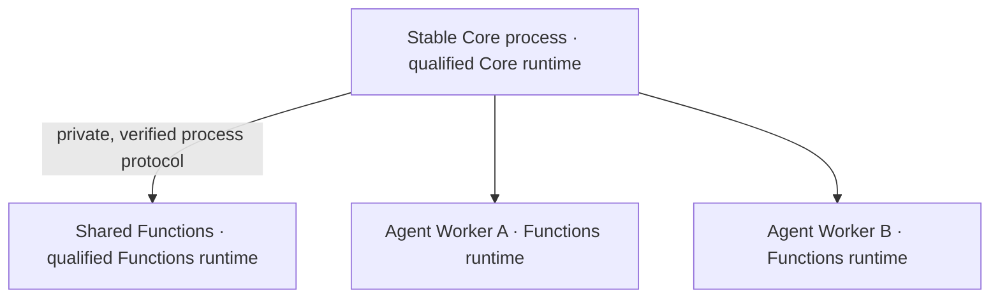

# HASHI v5.0.0-alpha.1 — Core and environment separation

Source candidate, prepared 2026-11-07. Python metadata: `5.0.0a1`;
Node/Helm application label: `5.0.0-alpha.1`.

These notes describe the v5 source and its upgrade boundary. They do not
announce a published installer, npm package, stable release, or production
adoption. The [release guide](RELEASES.md) distinguishes those states.
[PR #140](https://github.com/Bazza1982/HASHI/pull/140) carries the migration.

## Why version 5

HASHI needs to keep running while its tools, providers, connectors and their
dependencies change. v4 already ran Functions in separate processes, but its
Core and Functions still relied on a coupled Python/dependency qualification
contract. Changing an application library could invalidate the runtime
expected by Core and make an ordinary feature update require a cold cutover.

v5 separates the long-lived HASHI Core from the application environment.
Core runs in its own qualified Python installation with **no third-party
application packages**. Shared services and Agent Workers run in a separately
qualified Functions installation. They communicate through the existing
versioned, private process protocol rather than sharing Python objects.

A compatible Functions dependency update can now replace or roll back that
environment while keeping the Core process, its interpreter and its protected
code unchanged. Core still uses Python; this upgrade removes its dependency
on the application's package set, not on a qualified Python runtime.

This is a major version because the protected bootstrap, process construction
and runtime-admission contracts change. HASHI's numbering is **Core generation
. functional generation . maintenance revision**; see the
[versioning policy](HASHI_VERSIONING_POLICY.md). The `alpha.1` suffix describes
whole-release maturity and does not mean that all deployment profiles are
accepted for production.

## What is independent now

| Identity | What it represents | Upgrade boundary |
|---|---|---|
| Core code (C) | Protected bootstrap and process/protocol contracts | An authorized, independently reviewed Core generation |
| Core runtime (CR) | The Core interpreter, standard library, ABI and sealed installation | Separate native qualification and an explicitly planned cold cutover |
| Functions runtime (FR) | The interpreter and complete locked application dependencies | A qualified compatible replacement or rollback through the normal Functions handoff |
| Function generation (FG) | Immutable product source and resources | The existing Agent-scoped or shared Functions adoption path |

These are compatibility and provenance identities, not four competing product
version numbers. The [runtime contract](HASHI_PYTHON_RUNTIME_COMPATIBILITY.md)
remains their authority.

An Agent-only reboot replaces the selected Worker. A shared Functions handoff
can replace shared services and running Workers, with a service gap, while
Core keeps its identity. Remote retains its own lifecycle; the existing
supervisor/lifecycle owner restores availability after a shared handoff.
A different Core interpreter or incompatible protocol is never smuggled
through a hot Functions update.

## Runtime and installation changes

- **Separate, immutable environments.** Each role has its own exact package,
  interpreter, base-file and compatibility checks. Core has an empty
  application lock; Functions uses the complete standard lock and hashed
  wheels. New candidates are built in fresh destinations, never installed
  over a running interpreter.
- **Controlled startup and recovery.** The installer-owned selection binds the
  qualified Core and selected Functions runtime. Real startup keeps
  `-I -B`; the actual `main.py` establishes its controlled source path before
  product imports, without `PYTHONPATH` or current-directory fallbacks.
  Private startup messages bind the runtime, source generation, nonce and
  OS-observed process identity before product code executes.
- **Strict seals after normal use.** Bundled Remote, native MCP servers and
  generated Python hooks disable bytecode writes. Normal activity must not
  add caches to sealed environments. Qualification still rejects changed
  files, startup injection and unexpected packages; no cache exclusion weakens
  the seal.
- **Functions security maintenance.** The canonical standard lock includes
  aiohttp 3.14.4, certifi 2026.10.19, multidict 6.9.1, Pillow 13.0.0 and
  yarl 1.25.1. Derived wheel locks and distribution profiles must match the
  canonical inputs. These are Functions updates, not packages added to Core.
- **Distribution paths use the same split.** npm/source preparation, Windows
  launchers, Portable Windows and enterprise images prepare and qualify the
  appropriate independent roles. Portable payloads preserve the full files,
  verify them before execution, and requalify at the final installation path.
  A transfer image, expanded installation and rollback copy have different
  space requirements.
- **Clearer version diagnostics.** Structured version/topology data separates
  the admitted Core and observed Functions runtime identities and PIDs from
  source and FG facts. A missing Core receipt remains unknown; a checkout
  version cannot stand in for a running process.

Use the [installation guide](INSTALL.md) and
[dependency profiles](DEPENDENCIES.md). Source/npm preparation is not proof
that a particular published artifact or platform has been qualified.

## Reliability fixes included in the migration

The non-production migration exposed real boundary defects; their fixes are
part of the source candidate:

- Local Remote readiness no longer fails solely because an unrelated
  advertised peer is untrusted. Untrusted peers remain rejected, and
  authenticated connection checks remain required.
- `/bg` retains trusted frontend identity and routes its activity Session
  separately from the originating conversation, including Backend API
  transport registration and completion delivery.
- Scheduler tools carry bounded Run/Agent/instance capabilities. The frontend
  settings adapter also forwards the authenticated request context to the
  existing Scheduler handlers, so permitted writes work through both routes.
  This does not grant an Agent the management token or change ownership checks.
- Worker crash recovery and Agent start/stop/reboot use the qualified
  immutable generation. Terminal outcomes, cancellation scope and recovery
  remain observable; an application Worker failure is not a reason to restart
  the whole Core.
- Management qualification can check an independently replaced Functions
  installation from the fixed qualified Core anchor and run full Functions
  imports through the existing private child channel.

The owning [PAO](HASHI_PAO_SYSTEM_DESIGN.md),
[Frontend Connector](HASHI_FRONTEND_CONNECTOR_ARCHITECTURE.md),
[background-job](HASHI_BACKGROUND_JOBS_DESIGN.md) and
[Remote](HASHI_REMOTE_PROTOCOL_SPEC.md) contracts define the behavior.

## Other changes carried forward since the v4 Beta

The runtime split is the reason for the new major generation. The source also
contains product work that was not collected in one release overview. This
table summarizes it without turning an optional or experimental capability
into a default:

| Area | User-visible change | Details and boundaries |
|---|---|---|
| Engines and models | HERV3 keeps a durable Engine Session and one model/tool loop. Native Ollama adds opt-in, exact-model capacity and reasoning controls. | [HERV3](HERV3_UPGRADE.md), [Ollama](HERV3_OLLAMA_CONTEXT_PILOT.md); capabilities and instance opt-ins still govern availability |
| Conversations and controls | Durable Sessions, Runs and Events support confirmed admission, cancellation, refresh/re-entry and reconnect recovery without replaying accepted work. Agent Workzones keep exact, Run-frozen access roots across conversations. | [Sessions and client protocol](HASHI_PERSISTENT_MULTI_SESSION_FRONTEND_DESIGN.md), [Workzone boundary](HASHI_AGENT_WORKZONE_SESSION_BOUNDARY_FIX_2026-09-27.md) |
| Permissions and audit | Scoped requests, human decisions, durable receipts and recovery distinguish permission, actual execution and uncertain outcomes. Windows L2 isolation has a separate qualification path. | [Permissions](permissions/README.md); L2 is not enabled or universally certified by this release |
| Context and documentation | A compact FYI catalogue leads Agents to owning domain guides and scoped documentation retrieval; PCM keeps its own authority and memory boundaries. | [Agent reference](AGENT_FYI.md), [PCM](HASHI_PCM_SYSTEM_DESIGN.md), [Memory+](MEMORY_PLUS_V2.md) |
| Agent portability | Move transfers a durable Agent identity; Clone creates an independent identity from a checked snapshot. Resumable transactions, receiver validation and source-cleanup receipts preserve their different semantics. | [Move and Clone](HASHI_AGENT_MOVE_V1.md); this does not copy an installed software environment |
| Files and tools | Owner-scoped attachment/content handling, isolated OCR and configurable vision support richer file work without installing native extras into Core. | [Tools](tools.md), [dependencies](DEPENDENCIES.md); provider, permission and optional-profile limits apply |
| Speech and calls | Shared voice providers, Compute-backed services, manual speech direction, Safe Voice and interpretation/context handling have clearer selection, cancellation and failure outcomes. | [Voice guide](agent-guide/voice.md), [Phone interpretation](HASHI_PHONE_INTERPRETATION.md); configured services and explicit controls are required |
| Artifact provenance | Opt-in Fingerprint records exact-version evidence for controlled writes and distinguishes a completed business effect from evidence/marker failures. | [Fingerprint](HASHI_FINGERPRINT.md); off by default, not a replacement for permissions or runtime qualification |
| External clients | Backend/Session APIs retain authenticated routing and authoritative task state; HASHI's TUI and messaging connectors remain included. | [Connector architecture](HASHI_FRONTEND_CONNECTOR_ARCHITECTURE.md); external client applications are independently maintained |

## Upgrading an existing instance

1. Record the exact current source, services and runtime selection. Back up
   configuration, credentials, databases, workspaces and a recoverable complete
   previous installation.
2. Prepare a clean complete candidate and fresh qualified Core/Functions roles
   using the supported installer or source preparation. Do not convert the old
   coupled environment by removing packages or installing over it.
3. Qualify the actual entrypoint and complete required Functions imports on the
   target OS and final paths. Reject an incomplete or contaminated candidate.
4. Schedule the initial v4-to-v5 Core cutover explicitly. Changing the protected
   bootstrap is a Core migration; it is different from a later compatible
   Functions-only update.
5. Verify instance identity, credentials, endpoints, Agents, real tasks,
   stop/recovery controls and runtime identities after adoption. A health page
   alone does not prove the system can execute work.
6. Keep the rollback snapshot until acceptance is complete. Functions rollback
   preserves Core only while the selected role/protocol/source combination is
   compatible; downgrading Core or persisted data requires its own plan.

A merge updates source on `main`. It does not restart an existing service,
upgrade an active Python environment, publish a registry package or create a
GitHub Release. Never relabel an older qualified artifact as the new commit.

## Publication and validation boundary

The candidate's exact source, qualification and live evidence belong in its
review/CI records. Earlier checkpoints retain their original commit and
failure history. A test run spanning different candidates cannot certify one
frozen release.

Before release, follow the [checklist](RELEASE_CHECKLIST.md), including the
independent protected-Core review and the complete required CI workflows.
Installer and OS/profile acceptance, production adoption, optional privacy L2
and enterprise deployment remain separate facts. The v5 label does not
activate them or certify untested configurations.
