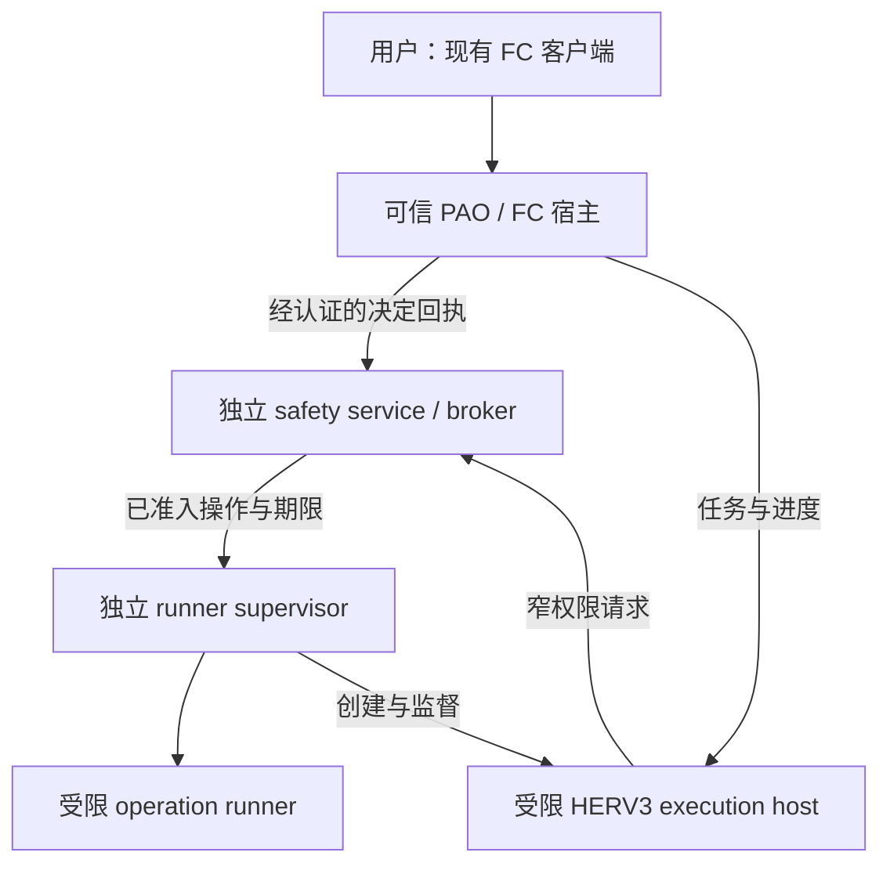

# Windows L2 权限边界施工方案

| 项目 | 内容 |
|---|---|
| 文档版本 | v1.1 |
| 日期 | 2026-10-23 |
| 状态 | **设计未实施；本文所有 Windows 平台验收均待执行** |
| 源码基线 | `d6b6513973bfc8f9f22c40ddd8f72802f907baa0` |
| 功能主责 | PAO：权限权威、任务生命周期与执行准入 |
| 协作主责 | HERV3：受限执行接入；公共 FC Functions：身份验证与标准交互投影 |
| 工程层 | Functions、独立 Windows sidecar、平台与实例配置 |
| 本期范围 | HASHI 仓库内实现；不修改 protected Core、外部客户端或 Telegram 专用 connector；不改变普通 `ask_user` 语义 |

本文规定 Windows L2 的主实现路径、施工分包、边界和验收。它没有声称现有代码已经具备 AppContainer 隔离、可信批准回执、独立安全服务或自动回收能力。新增模块、接口、服务名和安装参数均是施工契约，不是当前可运行命令。

领域命名统一使用 `AccessRequest`（权限申请）、`ApprovalDecision`（批准／拒绝的决定依据）、`PermissionLease`（有效授权记录）与 `DecisionReceipt`（可信人类动作回执）。本文的 grant／lease 是 `PermissionLease` 的说明性同义词，不表示额外实体或另一套账本。

## 1. 唯一主推荐与产品不变量

**保留可信 PAO／FC Function 宿主；新增受限 HERV3 execution host；由独立 Windows safety service／broker 决定权限，由独立 runner supervisor 创建和回收执行进程。**

PAO／FC 宿主继续处理既有用户认证、会话、命令、前端交付和任务恢复。HERV3 推理与模型发起的工具调用进入新的受限执行域，不与 FC 凭据、批准身份或主机执行权限共处。安全服务是最终授权权威；宿主缓存和 UI 只呈现它的结果。

首个完整验收组合为 Windows 原生、已验证的 AppContainer／LPAC profile、受保护的审批入口，以及无法操作审批环境的执行路径。此组合不依赖 WSL。未通过同样验收的 runner、操作系统、第三方 backend 或桌面通道不显示完整 L2。

必须同时成立的产品不变量：

1. **L0 保持旧路径。**未启用 L1/L2 时，不增加服务安装要求、权限数据库依赖、权限弹窗、默认围栏或新的 backend 准入限制。
2. **L1/L2 保持同一体验。**代理申请所需能力，用户通过现有 `/safety` 通用 commands/actions 选择范围与期限，批准后自动恢复原操作。L2 加强实际执行边界，不要求同一动作额外批准两次。
3. **有效批准不反复询问。**同一任务、同一批准范围及有效期限内自动签发短执行许可；范围扩大或批准失效时只询问增量。
4. **任务结束回收临时能力。**本期普通审批不提供永久选项，`indefinite` 申请不能生成临时授权。长期基础配置仅由可信用户通过独立策略管理动作维护，不能混同本次临时批准；代理不因此取得永久管理 token、永久高权限进程或无限期网络连接。
5. **拒绝不能被代理绕过。**模型不能通过伪造身份、换 backend、调用旧 IPC 或请求系统服务代做被拒绝动作。
6. **兼容性不阻断客户工作。**手动切换或用户预先配置的 fallback 遇到不受控 backend 时，说明差异、更新实际状态并继续。受保护步骤等待授权或恢复期间，独立任务步骤和已有成果仍可使用。
7. **目标等级与实际保证分开。**“设定 L2”不等于“当前完整 L2”。身份链、执行器、网络或回收边界任一关键依赖失效，都要同步反映到实际能力。

## 2. 信任域、主机边界与源码落点

### 2.1 进程职责

| 组件 | 可信职责 | 不得持有或执行的能力 |
|---|---|---|
| PAO／FC Function 宿主 | 用户入口、标准命令与交互、会话／任务状态、可信人类动作来源 | 不运行模型生成的任意代码；不把审批凭据、全部实例配置或普通 generic worker IPC 交给执行 host |
| Approval bridge | 将经过认证的具体用户决定转换为服务端回执，向 safety service 提交 | 不接受 agent 自报的 `actor_id`、`approved=true` 或普通聊天回答作为授权证据 |
| Safety service／broker | 策略与 grant 账本、原子准入、批准验证、文件／网络／凭证代理、撤销 epoch | 不运行任意 shell；不在服务身份下加载工作区插件；不把服务或用户 token 传给 runner |
| Runner supervisor | 创建受限 token/profile、启动和监督进程、拥有 job、落实 deadline、回收 | 不批准申请，不持有审批密钥，不决定扩大 scope，不执行模型脚本于自身进程 |
| HERV3 execution host | HERV3 推理、Engine Session 恢复、经 broker 发出的工具请求 | 无安全服务管理权、无批准身份、无任意主机文件／网络／桌面能力 |
| Operation runner | 获批 shell／脚本的实际执行 | 无其他任务授权、原始业务 secret、审批环境、通用系统控制 IPC |

Safety service 和 runner supervisor 是独立发布、独立管理的 Windows 服务进程。它们可以属于同一个安装包，但不得与不可信 execution host 合并。文件／网络／凭证 broker 是 safety service 的受控动作模块；若实现时拆进程，其身份和接口必须维持本文同样的边界。

图中的连线不是“持有对方全部权限”。每条调用都需要端点角色、真实调用身份、任务与代次绑定。HERV3 和 operation runner 只接触执行端点；批准、策略和服务管理端点不向它们开放。

### 2.2 本期威胁边界

需要抵御：恶意模型输出、prompt injection、恶意工具参数、在获批 scope 内运行的任意脚本、同一实例中试图偷用其他任务能力的受限代理，以及 agent 控制的结果／日志／文件内容。

完整 L2 的成立条件是 agent 没有管理员、调试特权、内核能力，也不能控制可信部署、批准身份或审批桌面。普通 Windows 服务不提供对管理员或完整主机失陷的免疫。若 L0／外部 CLI 拥有这些能力，应显示保证不足并继续用户选择的兼容工作，不能把它当作已经隔离的 L2 agent。

### 2.3 本仓库落点

现有基线包含以下实际情况：

- `orchestrator/function_worker_supervisor.py` 的 `prepare_worker` 是普通 multiprocessing spawn；它不是 OS 沙箱。
- 同文件的 `handle_worker_request` 还能分发 agent、service、route、scheduler 等能力；该通用管道不能原样交给 L2 execution host。
- HERV3 的现行入口仍带有 `adapters/her_v2.py`、`orchestrator/her_v2/` 等兼容命名；实现应接现行 v3 singleloop 与其 adapter，不恢复已退出的阶段式工作流。
- `tools/registry.py` 可以承担共同的动作规范化和工具准入，但 safety service 必须再次校验；不能只相信 registry 的预检结果。
- `orchestrator/workbench_api.py` 是 HASHI Backend API Functions 的历史文件名。允许在公共 permission 写入口做最小认证修补，不因此修改外部客户端。
- `orchestrator/run_questions.py` 的普通回答明确不授予权限；本设计不改变它或 `ask_user` 的产品契约。
- 只有 `orchestrator.runtime_contract.CORE_SOURCE_PATHS` 是 protected Core 路径的权威来源。目录名和文件名含 `core` 与否不能替代现有保护检查。

建议新增 owner 路径如下；最终文件拆分须跟随实际职责，不能复制另一份权威状态：

| 建议路径 | 职责 |
|---|---|
| `orchestrator/permissions/` | 共同契约、L1/L2 client、可信 actor admission、标准交互投影、实际能力报告 |
| `runners/permission_host/`，由 HERV3 adapter 薄接线 | 将现行 HERV3 engine 以明确数据契约接入受限进程 |
| `services/permission_service/` | 独立 safety service、账本、approval bridge 协议、资源／网络／凭证 broker |
| `services/permission_service/windows/` | native launcher、runner supervisor、Windows 身份与对象安全封装 |
| `scripts/permissions/` | 独立测试服务的安装计划、检查、升级／卸载工具；默认不操作生产 |
| 现有 platform／instance 配置层 | 服务地址、已登记身份、测试实例、受信发布物和已验收 profile；生产 secret 不进入仓库 |

任何新 native 或可选 Python 依赖使用独立 sidecar 环境，不能安装进运行中的 Core interpreter。普通 Functions 接入沿用现有代次采用机制；不要求修改或冷重启 Core 来加载权限业务。

## 3. Windows 身份和 OS 权限矩阵

### 3.1 主方案账户

首期测试安装创建两个专用、非管理员、本地服务账户：安全权威账户与 runner supervisor 账户。名称带随机测试实例标识，不复用生产账户。二者分别运行自己的服务，并使用各自 service SID 对资源授权。

| 主体 | 所需身份／权限 | 明确不授予 |
|---|---|---|
| 测试安装操作者 | 对独立测试服务、测试账户和测试目录的安装／卸载权限 | 不因测试自动获得或使用生产服务管理范围 |
| Safety service 账户 | 服务登录；自身安装目录只读执行；私有账本／密钥目录按需读写；其 broker 资源权限 | 不加入 Administrators；不保留调试、接管所有权、备份绕 ACL 等广泛 privileges；不把服务 token 下放 |
| Runner supervisor 账户 | 服务登录；自身受信 runner 发布物只读执行；任务 profile／暂存目录管理；自身创建进程与 job 管理 | 不读取批准私钥／业务 secret；不修改安全账本／服务配置；不读取任意用户文件 |
| 单任务 execution host／runner | supervisor 基础 token 派生的 AppContainer／LPAC token；精确 task profile 与能力 | 不具有未受限基础 token、service 管理接口、其他 task 目录／句柄或任意 network capability |
| 可信 owner-session 文件 helper | 使用用户已有文件权限，仅执行服务登记的具体资源动作 | 不将用户 token／全目录句柄交给 agent；不把普通模型请求当用户同意 |
| 可信 PAO／FC／approval bridge | 已验证的用户来源；受保护决定端点；保存必要认证材料 | 不允许 agent 进程写代码／内存、读凭据或调用其批准私有接口 |

主启动方案由 supervisor 在**自身非管理员 token 下**创建 AppContainer／LPAC 进程，使用 `STARTUPINFOEX` 的安全属性，不以持有全机管理员或 LocalSystem 身份为前提。[M2] 若实际 API 组合需要 `CreateProcessAsUserW`，必须独立证明所需 privileges，并限制在 launcher；不能因遇到权限错误便把整个服务改成 LocalSystem。Microsoft 文档明确该 API 的 privilege 要求及受限 token 特例。[M7]

安装时设置所需 service SID 和最小 `SERVICE_REQUIRED_PRIVILEGES_INFO`。service SID 是 ACL 主体，不等于高权限账户；`SERVICE_SID_TYPE_UNRESTRICTED` 的名称也不表示服务获得任意主机访问。使用 `RESTRICTED` 增强模式须先通过服务自身资源兼容性验收，不凭设置成功就宣布 runner 已隔离。SCM 会按服务声明裁剪不需要的 privileges，但这不替代应用资源 ACL。[M8][M9]

### 3.2 对象 ACL 与句柄矩阵

下表是安装器必须生成并验证的权限结果，不是可直接复制到生产的宽泛 SDDL。ACL 使用安装时解析出的 SID，不能依赖中文／英文账户显示名或固定机器路径。

| OS 对象 | 允许主体与最小访问 | Agent 必须不能取得的能力 | 验证方式 |
|---|---|---|---|
| 安全服务 exe、解释器、依赖及父目录 | 安装操作者维护；服务读取执行 | 写入、重命名替换、修改 ACL、借可写父目录替换 | 受限 token 尝试文件和目录替换；复核所有父级 ACL |
| 安全服务账本／密钥／恢复 epoch | 仅指定 authority／维护流程 | 读私钥、写状态、用旧副本覆盖、删除／改 ACL | 真实文件访问；从 agent／runner token 读取失败 |
| runner 安装发布物 | 安装者维护；supervisor 与 runner 只读执行 | 通过 cwd、PATH、动态 import、DLL 搜索路径替换宿主代码 | 不可信工作区投放同名依赖后启动隔离 fixture |
| 服务 SCM 对象 | 安装者管理；普通状态读取按需要单独授予 | `SERVICE_STOP`、`SERVICE_CHANGE_CONFIG`、`DELETE`、`WRITE_DAC`、`WRITE_OWNER` | 逐权利执行 OpenService／控制测试，不只测 UI |
| service／bridge／supervisor 进程和线程 | 可信管理者按职责；不共享 ALL_ACCESS 句柄 | terminate、suspend、create-thread、VM read/write、duplicate-handle、改 DACL | 真实 OpenProcess／线程／句柄复制测试 |
| 服务／owner 的 token 对象 | 只在可信域内使用必要 token 操作 | `TOKEN_DUPLICATE`、`TOKEN_IMPERSONATE`、privilege 调整、primary token 取得 | 受限进程尝试打开和复制 token |
| execution pipe | 服务与已登记的执行实例；细分必要读写权限 | 创建同名服务端、访问 approve/admin、假冒其他任务 | 显式 DACL＋服务端 token 与登记表校验 |
| approval/admin pipe | 已登记可信 bridge／维护者 | execution host 和 ordinary worker 调用 | 不同真实 token 逐端点连接和方法调用 |
| task profile／staging | 当前 task package SID、supervisor 的必要管理权 | 跨任务读写、继承其他 grant、改资源父目录权限 | 双任务并发攻击与清理后复用检查 |
| job 对象及管理句柄 | supervisor 独占长期管理句柄 | agent 关闭、复制、修改 limits、breakaway | 句柄清单及恶意 duplicate／open 测试 |
| 审批浏览器 profile／FC secret／bridge 配置 | 可信人类入口及宿主 | 普通 workzone 批准间接覆盖这些对象 | 大父目录批准仍不能取得保留资源 |

Windows 区分 SCM、进程、线程和 token 对象访问权。只禁止 `SERVICE_STOP` 不能证明进程不可被结束或注入；`PROCESS_DUP_HANDLE` 等权利还可能扩大已有访问能力。[M1][M5][M6]

named pipe 不使用默认 ACL。服务端应区分连接权和方法权，避免客户端以 `FILE_GENERIC_WRITE` 意外取得 `FILE_CREATE_PIPE_INSTANCE`；禁止远程／不相关会话连接，并验证实际 client token，而不是只看 pipe 名、localhost、PID 或 JSON 身份。[M4] PID 只能参与已登记进程句柄与创建时刻的绑定，不能单独证明调用者。

低权限 execution host 的主 IPC 路径由 supervisor 预建专用数据通道，并只通过显式句柄白名单把执行端交给目标子进程；接收端与可信创建记录绑定。它不是现有 generic Functions pipe，也不携带 approval/admin 能力。低权限 profile 直接连接 named pipe 的兼容性必须在 W01 验证，不能因连接失败而开放网络 localhost 管理端口或扩大管道 ACL。控制层、bridge 与 service 的管理／决定通道继续按各自 Windows 身份认证。

### 3.3 保留控制资源

安全服务、审批密钥、审批客户端会话、管理 token、FC secret 和能修改这些对象的进程／文件能力属于保留控制资源。普通文件、shell 或整个用户目录的批准不能隐含开放它们。

若用户明确选择可以访问这些资源的第三方 backend 或宽权限模式，系统允许其兼容工作，但实际保证相应降级。不能一面把批准身份交给 agent，一面继续声明“agent 不能自批”。

## 4. 原生受限启动：不可信代码执行前完成边界

### 4.1 首选 profile

首选验证 **LPAC profile**；若实际 HERV3／工具链所需系统资源使 LPAC 不兼容，则验证明确能力集合的普通 AppContainer profile。二者是同一主方案的已登记 runner profile，均须通过本文相同的越界验收。[M2]

每个 execution host／operation runner 都有服务登记的 profile、基础身份、package SID、capability 集合、任务、operation、generation 和期限。不能凭 moniker 或 package SID 自报身份；也不能复用一个已累加多任务权限的全局 profile。

没有 network capability 是主默认。宿主推理、模型调用和结构化网络工具通过窄 broker 使用连接。只有已通过专门验收的 direct-network profile 才能改变这一默认，并准确披露发送能力。

### 4.2 启动步骤

以下顺序属于 launcher 的执行合同，不是已经存在的实现。

1. **固定动作。**authority 规范化操作、可信任务身份、资源集合和执行参数摘要。取得短期 reservation；此时不能运行业务代码，也未因预占而把 queued 操作视为已经执行。
2. **核验发布物。**supervisor 接受服务登记的 runner/profile，不接受模型提供任意 host exe、解释器、DLL 目录或 bootstrap 模块。验证安装发布物摘要和服务允许的版本。
3. **创建任务身份与目录。**按 supervisor 所属账户建立 AppContainer profile，取得 package SID；设置 task 私有目录、临时目录和日志对象 ACL。若同名 profile 已存在，核验所有者、原实例、代次和清理记录；不得因“存在”就直接继承旧资源。[M2]
4. **准备数据与资源。**HERV3 host 只取得任务数据、必要上下文和 broker 引用；不复制全量宿主配置。shell runner 只取得该操作已批准的输入／工作区。所有控制平面保留对象排除在可见范围外。
5. **构建 token／属性。**在低权限基础身份上建立 AppContainer／LPAC。通过 `PROC_THREAD_ATTRIBUTE_SECURITY_CAPABILITIES` 传入 package SID 与实际需要的 capability；LPAC 加入 `PROC_THREAD_ATTRIBUTE_ALL_APPLICATION_PACKAGES_POLICY` 与 opt-out 策略。不能照搬示例中的 internet capability。[M2]
6. **构建干净环境。**显式 `lpApplicationName` 指向受信绝对路径；显式 argv、cwd 和新环境块。拒绝沿用宿主 PATH、Python import path、代理设置和 secret 环境。stdin/out/err 使用明确管道，禁止继承无关句柄。[M7]
7. **准备 job 与监督状态。**创建受保护 job，启用 kill-on-close，禁止 breakaway，设置所需资源上限。注册 deadline、task、operation 和取消入口。job 的唯一长期管理句柄留在 supervisor。
8. **suspended 创建进程。**使用 extended startup attributes 与 `CREATE_SUSPENDED` 创建；此时不 resume 主线程。当前进程还没有运行任何模型脚本、用户插件或不可信 bootstrap。
9. **加入 job 并检查真实属性。**成功 AssignProcessToJobObject；核验进程实际 token、package SID、capability 集合、继承句柄、profile、job 归属与 deadline。任一步失败，终止 suspended 进程并清理，不落回普通 shell。
10. **做最终 start 准入。**以相同 operation_id 向 authority 执行 `commit_start`，重新检查最新 grant epoch、期限、policy revision、参数摘要及单次额度。这个原子提交是“开始用权”的线性化点。
11. **立即启动并记录。**supervisor 在受序列化的 launch gate 内处理已收到的撤销，再 resume。记录 `start_committed_at` 和实际 `resumed_at`。不能把 start receipt 放队列等待几十秒后使用；延迟或结果未知时先对账，不自行重建进程。
12. **持续监督与结算。**host／runner 输出是待验证数据；broker 请求仍逐操作检查。完成、取消、到期或故障后先关闭能力并确认资源清理，再发布最终回执和清理 profile。

撤销若在线性化点之前提交，尚在 queued／prepared 状态的动作必须不能启动。撤销若在线性化点之后到达，动作已进入 in-flight 清理范围；不能声称跨进程传播没有时延。已收到的撤销要优先于尚未 resume 的动作，不能用旧 start receipt 再启动。此顺序必须通过并发调度测试证明。

### 4.3 Job Object 的范围

Job Object 用于进程组、限制和清理，**不提供文件／网络／身份沙箱**。Windows 文档明确 child process／breakaway 规则，并指出 WMI 创建进程可能不在普通 job 继承关系内。[M3]

因此必须同时限制 WMI、计划任务、服务创建、COM／RPC 代理执行等逃逸入口。不得只在任务结束时枚举 PID，然后把“已杀掉已知 PID”当完整回收证据。所有可执行代理路径都必须得到 scope、deadline 和返回 operation receipt，否则对应能力为 unmanaged。

### 4.4 兼容替代准入

某工具不能在首选 profile 运行时，先返回具体缺失能力，由用户选择兼容动作；不自动删除 AppContainer 属性重试。

可登记另一受限 runner，包括组合 restricted token 与资源约束的实现或同机 VM，但必须提交相同文件、网络、身份、IPC、任务隔离及回收证据。`CreateRestrictedToken`、另开进程、容器名称或 Job Object 都不能单独作为准入证明。没有通过时，可使用结构化工具或用户选择的不受控 backend，并如实显示控制缺口。不得强装 WSL 作为唯一继续路径。

## 5. 十二个施工包

所有包当前状态均为**待实施**。依赖表给出可并行顺序；包的退出条件引用第 9 节的 WAC 平台验收，不代表它们已经执行。

| 包 | 核心产物 | 依赖 |
|---|---|---|
| W01 | 基线、威胁拓扑和 Windows profile spike 报告 | 无 |
| W02 | 独立测试服务发布／账户／安装计划 | W01 |
| W03 | 对象安全、可信登记与 ACL 验证器 | W02 |
| W04 | 权威账本、窄 IPC 和批准回执合同 | W01、W03 |
| W05 | permission-only 可信用户入口与 `/safety` 标准交互 | W04 |
| W06 | 受限 HERV3 execution host 及旧 generic IPC 隔离 | W04 |
| W07 | AppContainer／LPAC 原生 launcher 与 job | W03、W06 |
| W08 | 每任务文件范围与结构化文件／shell 执行 | W04、W07 |
| W09 | 模型／网络／业务凭证代理 | W04、W07 |
| W10 | 原子用权、撤销和故障监督 | W04、W07、W08、W09 |
| W11 | 恢复、升级、回滚和残留清理 | W02、W10 |
| W12 | 能力报告、混合等级及平台发布门槛 | W05—W11 |

与主施工计划的阶段对应关系：**M07** 承接 W01—W05 的独立服务、身份、窄 broker 和公共认证接入；**M08** 承接 W06—W09 的受限 HERV3 host、launcher 和资源代理；**M09** 承接 W10 与 W11 的撤权、故障、恢复及适用 Windows 验收；**M10** 承接 W11 的发布／升级／回退部分与 W12 的采用门槛。W05 复用共同权限交互，不重新设计前端或普通问答。

### W01 — 固定边界与 Windows spike

**输入：**本文件基线、现行 HERV3 singleloop／adapter、FC 认证路径、Core manifest、测试实例需求。

**施工：**

- 保存 L0 旧路径启动、工具、backend、取消、问答和命令的可观测基线；启用服务不得成为 L0 运行前提。
- 画出实际服务、PAO／FC、Remote、HERV3、MCP／桌面 sidecar 和文件／secret 的持有关系；记录哪些路径还直接使用主机权限。
- 在独立 Windows 测试账户中验证 LPAC／AppContainer 能否启动受信解释器、实际 HERV3 小任务及代表性 shell 工具；记录缺少的 capability、profile、文件及系统依赖。
- 核验 service-logon 场景下 profile 创建、任务目录、named pipe 和长进程清理。不能用交互桌面上跑通一段示例替代服务部署验证。
- 明确最低首发 Windows build／架构／依赖组合；未经测的平台保留 unknown，不按 API 最低系统版本推断产品支持。

**产物：**L0 基线记录、可信边界图、runner compatibility manifest、实际凭据持有矩阵、未覆盖路径清单。

**OS 设置：**仅独立测试账户／目录；不修改生产防火墙、服务或用户 profile。

**退出条件：**WAC01、WAC02 的可执行验收计划齐备；不能仅以“AppContainer API 存在”结束 spike。

### W02 — 独立服务、测试安装和最小账户

**输入：**W01 的平台组合与身份矩阵。

**施工：**

- 独立打包 safety service 与 runner supervisor；所有依赖固定到发布物，不引用可编辑 workzone 或运行 Core 的 Python 环境。
- 安装器先输出 install plan：测试服务名、账户／SID、每个文件路径、拟设置 ACL、pipe 命名空间、状态目录和卸载范围。
- 测试服务统一带独立命名空间，例如 `HashiSafetyTest_<id>` 与 `HashiRunnerTest_<id>`。这是命名契约；当前并不存在可直接运行的安装命令。
- 创建非管理员服务账户、授予必要 service logon、配置 service SID 和最小 required privileges；禁用不需要的交互登录用途。
- 仅设置本测试服务的失败恢复、日志目录和启动方式；不扫描并“修复”生产 HASHI 服务，不自动重启生产 Core／Functions／Remote。
- 安装失败以记录的资源清单回滚，仅移除本次创建且身份一致的对象，不递归清理其他实例目录。

**产物：**独立安装包、install/uninstall plan、账户与 ACL manifest、安装回执、隔离测试配置。

**OS 设置：**遵循第 3 节；不使用 LocalSystem 运行任意脚本；不将生产 secret 写入参数、日志、测试 fixture 或仓库。

**退出条件：**WAC03、WAC04、WAC32；管理员维护独立测试服务可用，agent 无服务管理能力。

### W03 — SCM、进程、token、文件和 IPC 对象安全

**输入：**W02 发布物／账户、对象矩阵和 Windows API 封装。

**施工：**

- 安装期设置并复核所有安全对象及父目录 ACL；服务启动时检查关键 ACL 和安装路径，发现不一致时使 L2 能力 unavailable，不能带缺口继续显示 enforced。
- 分离 execution、approval、admin 三类 pipe。限制连接主体和方法集合；拒绝远程或不属于当前实例的连接。
- 连接登记绑定实际 client token、进程持有句柄／创建信息、instance、agent、task、generation；PID 重用不复用身份。
- 禁止从普通 agent 的 bearer token 取得批准端点；服务端忽略 agent payload 中的 scope owner 与 approved 字段。
- bridge／service／supervisor 不向子进程继承管理句柄、token 或 job；逐项限制 process/thread/token 权利，避免只保护 SCM。

**产物：**对象安全封装、安装自检、真实 token admission、连接登记表、拒绝原因代码。

**OS 设置：**第 3.2 节矩阵全部逐项落实；named pipe 使用显式细分读写权，防止假服务端与越权方法调用。

**退出条件：**WAC05—WAC08、WAC12。失败路径必须有 OS／服务端证据，不能只有 UI 禁用。

### W04 — 权威账本、接口角色与正式决定

**输入：**共同 L1/L2 产品模型、W03 身份登记。

**施工：**

- safety service 唯一持久化 `AccessRequest`、`ApprovalDecision`、`PermissionLease`、operation、epoch 与回收状态；HASHI 本地仅持有投影或缓存。
- 建立 `evaluate`、`request_access`、`acquire_execution`、`prepare/start`、`complete/status`、`revoke`、`settle_task`、`effective_controls` 等稳定语义。外部字段名可跟随共同合同，不在本文件另立第二套产品模型。
- agent 端点只能操作自身任务；正式 `decide`、policy、level、服务管理在独立角色端点。任何代理接口不得间接转发任意管理方法。
- 一次正式决定绑定认证 principal、`AccessRequest.request_id`、规范化 scope／参数摘要、期限、task、generation、nonce 和幂等键。
- 同一请求重复提交返回同一记录；同一幂等键换内容拒绝。单次额度、start 状态和 epoch 在事务内线性化。
- 审计记录按 operation 关联，不记录原始 secret；服务不得把日志内容当作重新执行指令。

**产物：**service API、schema／迁移、角色矩阵、原子事务、最小审计与回执。

**OS 设置：**账本、密钥和 epoch 由服务私有身份持有；普通 worker 不直接访问数据库。

**退出条件：**WAC09、WAC10、WAC21、WAC22；不能因客户端声称已批准而跳过服务校验。

### W05 — 可信入站与既有 `/safety` 通用交互

**输入：**W04 request／decision 合同、公共 FC commands/actions、既有认证凭据。

**施工：**

- `/safety` 状态、申请、期限选择、批准、拒绝、撤销及能力说明使用现有通用命令／交互动作，不新增客户端私有 UI；文案复用 command UI helpers 和语言目录。
- **只对 permission 写动作**在公共 Backend API／FC Functions 做严格身份校验。personal 模式不能仅从配置返回 owner；governed 模式使用有效用户 session 和可管理范围。
- 经认证的入口创建 server-only `DecisionReceipt`。它绑定 actor、来源、instance、agent、task、request、scope digest、选择、期限、nonce 和有效期，并经受保护 IPC 或签名传给 bridge。
- receipt 不进入模型上下文；客户端仍使用现有 action payload。客户端传入的 `authorization='allowed'`、`actor_digest`、`author='authenticated_user'` 不被当成证据。
- Remote HMAC 的实例认证必须与真人授权区分。若 agent 能读取旧共享 secret 或让代理用更强 admin token 代调决定接口，必须先迁移／隔离凭据、限制代理方法，不能只加 token 比较。
- 普通 `ask_user`、RunQuestions 回答及自由文本保持原语义，不投票授权。用户在普通问题中说“可以”不创建 grant；权限正式决定仅由已登记请求对应的可信 `/safety` action 产生。
- Telegram 专用 connector 不改；公共调用链若无法保留可信 actor 来源，该组合显示缺口。TUI 当前 direct/proxy 缺少可直接复用的认证头，不能宣称后端一行 strict_auth 已解决。请求、查看、普通任务仍可进行，批准可走另一个已连接受信 FC。

**产物：**permission-only auth hook、approval bridge、标准交互与状态文案、逐通道认证矩阵。

**OS 设置：**bridge 代码、凭据、审批会话与执行域隔离；审批环境不可被 agent 桌面／浏览器自动化控制。

**退出条件：**WAC09—WAC11、WAC27、WAC28。正常受信通道保持一次选择即继续，无新增客户端字段要求。

### W06 — HERV3 execution host 与 generic worker IPC 隔离

**输入：**现行 HERV3 adapter／singleloop、W04 broker 合同、已验证 Functions artifact。

**施工：**

- 在 Functions 中新增 HERV3 execution host；保留可信 PAO／FC 宿主，不把 bot 凭据、用户入口和批准服务一同移进不可信域。
- adapter 发送最小任务 DTO：可信绑定的身份引用、PCM／任务数据、Engine Session 增量、许可状态引用与工具目录。不得传入全部 `runtime/config` 对象、宿主 secret 环境或可写主机数据库路径。
- 原有 HERV3 logical Session、turn 和 checkpoint 语义保持；进程恢复通过已保存 Engine 状态继续，不用新建用户任务掩盖重启。
- host 内只保留 broker-backed 工具适配器。文件、shell、network、MCP／desktop sidecar 和后台任务都不能另有直接主机通路。
- 普通 `core.service.*`、start/stop-agent、scheduler、route 等 generic worker 管道不暴露给 host。必要公共业务能力使用 Functions 层新增窄 adapter，按真实 client/task 身份做 admission。
- L0 留在既有执行分支；L1 复用合同的进程内实现。不得用全面重写 worker 启动来破坏 L0 原行为。

**产物：**execution-host 数据合同、HERV3 adapter 接入、隔离 IPC、checkpoint／取消桥接、旁路清单。

**OS 设置：**host 仅由 W07 supervisor 创建；禁止从可信宿主直接普通 spawn 模型脚本作为“临时兼容”。

**退出条件：**WAC01、WAC02、WAC12、WAC13；直接 HTTP／shell／文件调用不能绕过 broker。

### W07 — LPAC／AppContainer launcher 与受管理进程

**输入：**W01 profile 兼容结果、W03 对象安全、W06 host artifact。

**施工：**严格实现第 4 节的十二步启动顺序，并为每一步建立失败清理；真实检查 token、capability、job、句柄和期限后才允许 `commit_start`／resume。

- host 与 shell operation runner 使用各自已登记 profile；不能共享一个累加权限的 AppContainer。
- 默认不赋 network capability，不连接用户交互桌面，不授予 UIAccess 或其他可控制审批环境的能力。
- stdout/stderr 和控制流使用长度受限的数据协议，不反序列化任意对象或运行工作区代码来“解析结果”。
- job 禁止 breakaway；限制可逃离子进程树的系统服务／代理执行。process、job 和 pipe 句柄不泄漏给不可信子进程。
- 兼容失败给出 profile、缺失能力与可选处理，绝不隐式重试无沙箱 CreateProcess。

**产物：**native launcher、runner supervisor、profile manifest、实际启动回执、失败清理程序。

**OS 设置：**AppContainer／LPAC、受限服务基础身份、suspended create、job、明确属性和环境；不强装 WSL。

**退出条件：**WAC13—WAC16、WAC23、WAC24。仅在 mock 中断言“调用了 sandbox=True”不能通过。

### W08 — 每任务文件范围、代理和 shell 工作区

**输入：**规范化 scope、工作区快照、W07 runner、可信 owner 文件权限来源。

**施工：**

- 首期主实现采用**结构化文件 broker＋服务管理的每任务工作区**。任意用户文件由可信 helper／broker 按已批准动作读取或写入；shell 看到的是明确映射后的任务路径。
- 产品批准与 Windows ACL 分开：服务无权读取某用户对象时，由受保护 owner-session helper 按用户已有权限执行精确动作，不把 user token 或目录总句柄交给 runner。
- 任务工作区 import 记录来源对象、内容／版本与允许动作；export 前再次检查当前 grant、目标真实对象和版本冲突。不能把 staging 当作无冲突透明挂载。
- 直接访问原项目仅在后续 profile 通过同样验收后启用；不因 shell 兼容性自动向所有 runner 账户开放用户目录。
- 解析真实目标对象；覆盖相对路径、父目录、UNC、盘符别名、junction/reparse point、大小写和创建目标父目录。校验与打开／替换动作之间不能留下可换目标的缺口。
- 并行 task 使用独立 profile／SID／句柄和资源引用。动态授权不能只靠向共用基础账户不断增加 ACL；授权和 revoke 都应按 task 反查资源。
- shell 批准绑定实际 capability 集合，不把可执行文件名或字符串匹配当完整复合脚本授权。安装依赖、启动服务、git 子命令等需要的能力一次合并展示，实际访问仍受限制。

**产物：**文件代理、路径／对象验证、task workspace、import/export 回执、冲突处理、受控 shell adapter。

**OS 设置：**每任务 staging ACL、保留资源排除、精确 helper 身份；不向 agent 开放用户 profile 的全部能力。

**退出条件：**WAC16—WAC18、WAC25；文件已被返回的数据不可撤回，产品说明不能把它称为回收成功。

### W09 — 模型出口、网络和凭证代理

**输入：**/privacy 约束、获批目标与动作、模型 provider 配置、业务凭证引用。

**施工：**

- 模型调用由专用 gateway／broker 执行；HERV3 获得调用能力引用，不获得原始 API key，也不因此获得访问任意 URL 的 HTTP proxy。
- 结构化网络工具按目标、操作、资源和数据范围执行。检查 redirect、DNS 解析变化、直接 IP、IPv6、代理、localhost 和 LAN；不把访问某本地模型视为访问整个局域网。
- 凭证代理按具体操作使用业务 secret。git、上传、数据库、API 请求不能把广泛 SSH key、cookie 或 token 放进 runner 环境。
- 原始网络 profile 如果允许向目标建立连接，要如实披露其发送能力。GET、域名白名单或“只下载”标签不能证明禁止数据外传。
- broker 回包、异常、日志和诊断去除可复用 secret；测试使用合成凭据和本地受控端点，不把生产账号接到平台攻击测试。
- 读取获批文件后发送到模型仍受既有 /privacy 规则约束；安全等级和网络许可不覆盖隐私规则。

**产物：**model gateway、结构化网络 broker、credential handle 合同、出站策略、脱敏与连接回收。

**OS 设置：**runner 无任意 network capability；只有 broker 获得必要网络和 secret 访问，连接归属到 operation。

**退出条件：**WAC19、WAC20、WAC25；无法独立限制上传的 profile 必须报告 partial。

### W10 — 单次操作、epoch、撤销与可信监督

**输入：**grant／operation 账本、W07 job、W08 文件资源、W09 连接和 secret 引用。

**施工：**

- `acquire` 以 operation_id 原子预占；`commit_start` 重新校验并进入 in-flight。两个并发调用不得消费同一单次批准，参数变更不得复用批准。
- service epoch／task generation／grant epoch 一并绑定。撤销事务先更新 epoch 和准入状态，再通知 supervisor／broker 清理。
- deadline 由可信 supervisor 持有，以单调时钟执行；grant 到期不等待下一次 model tool call 或客户端刷新。
- 一个 grant 对应的所有运行进程、broker 句柄、网络连接、设备会话和待执行操作可反查。撤销影响这些存活能力，不只是删除一行数据库。
- supervisor 拥有 job 的唯一长期管理句柄；agent 不继承。policy service crash/hang 后 supervisor 仍能按期限停工；supervisor 退出时依靠 kill-on-close 清理。[M3]
- PAO pause、cancel、task complete、agent 删除和 backend 切换都发出明确的 scope 结算；暂停不伪装完成，恢复须校验现有决定而非复活旧活动票据。
- 对结果未知的外部副作用保留 operation_id 与 receipt 状态，不因重试、切 backend 或重启而再次执行。

**产物：**start/revoke 线性化、可信时钟、heartbeat、资源反查、结算状态机、execution_unknown 对账。

**OS 设置：**监督与 job 不由 execution host 控制；控制域与任务域无可复制的管理句柄。

**退出条件：**WAC21—WAC26；计时与完成状态按第 6 节分别记录。

### W11 — 服务恢复、备份、升级与回滚

**输入：**服务版本／schema、活动操作清单、独立 epoch 状态、任务／Engine checkpoint。

**施工：**

- 启动时生成新运行代次，枚举并对账已登记 runner、job 和资源。旧执行票据不能直接复活；有效批准经当前策略验证后签发新执行许可。
- 备份恢复使用显式 restore 模式。旧数据库中的 active／approved 行不能覆盖较新的撤销信息；不能证明撤销连续性时，使旧授权不可执行，保留任务进度并重新确认缺失权限。
- schema 迁移采用单写者、可验证 migration 和版本协商。旧新服务不能同时修改同一账本；rollback 不能简单恢复旧数据库来“让旧版本能启动”。
- 服务发布物按版本并存；切换前核验真实签名／摘要和 ACL，不执行来自 agent 可写路径的升级脚本。仅散列校验而无可信预期值不足以验证发布来源。
- 升级前冻结新的受保护准入，按策略 drain 或停止活动操作，保存进度；升级后新 epoch、对账、恢复和能力报告验证全部完成才恢复该能力。L0 继续旧路径。
- 卸载先处置本实例的 runner／job／暂存与连接，再移除其服务；保留用户成果和必要审计。未知归属资源不能直接递归删除。
- 所有开发／验收升级操作默认仅作用于 `Hashi*Test_<id>`；不自动重启生产实例。生产部署是另行明确、可审阅的运维动作，不由本设计文档授权执行。

**产物：**restore／upgrade／rollback plan、迁移回执、残留资源报告、版本兼容矩阵和独立测试安装证据。

**OS 设置：**恢复 epoch／撤销证据不随普通数据库备份无条件回滚；安装者角色与 agent 身份分离。

**退出条件：**WAC26、WAC30—WAC32。全机／VM 快照连 OS 与全部持久锚点一起回滚的防回滚保证见第 6.4 节，不得超出同机机制能力。

### W12 — 真实能力、混合等级与发布门槛

**输入：**逐 profile 平台证据、逐 FC 认证矩阵、service／runner 当前版本和健康信息。

**施工：**

- `effective_controls` 由可信 service／平台验证结果产生，绑定版本、generation、profile、时间和失效期限；不能由 backend 自报 `supports_l2=true` 决定。
- 展示 configured level 与实际 filesystem/tool/network/credential/approval/lifecycle 等能力；过期、服务失联或配置发生变化时重新评估。
- 建立依赖传播：桌面或 L0 能读取批准身份时，trusted approval 和依赖它的授权保证同时降级，不能只改 desktop 标签。
- backend 切换时保留 task、operation 和已完成成果，回收旧执行能力；旧操作结果未知时不重复副作用。用户授权的兼容切换警告后继续，不要求第三方必须完整受控。
- 未知 Windows build、Linux/macOS、未验收 VM/profile、TUI 认证缺口和同桌面控制如实显示 unknown/partial/unmanaged/unavailable。
- 发布完整 L2 前通过全部适用 WAC；未实现或跳过的项不是 pass。未通过组合仍可兼容使用，但不能获得完整 L2 声明。

**产物：**能力报告、依赖规则、诊断投影、backend 切换回执、已验收组合清单和发布证据。

**OS 设置：**没有未验证平台的自动安装／提权／重启动作；用户选择更广权限环境时不掩盖保证变化。

**退出条件：**WAC27—WAC34，以及该组合所依赖的全部安全项。

## 6. 时序、回收和恢复的精确定义

### 6.1 三类期限分别计算

| 机制 | 首期建议值／语义 | 不能推导的结论 |
|---|---|---|
| 用户批准期限 | 单次、当前 task/run 或自选时长；全部临时 PermissionLease 均受任务提前结算和撤销约束 | 普通审批没有永久选项；独立管理的长期基础策略不是临时批准 |
| 启动票据 | 建议上限 60 秒；仅是尚未执行票据的有效窗口，最终 start 仍查最新 epoch | 票据未满 60 秒不代表撤销后还可启动 queued 操作 |
| 心跳 | 建议 5 秒一次，连续 3 次缺失触发失联判断 | 从故障发生到发现可能约 15 秒，不能写成 5 秒内全部回收 |
| 普通可取消资源清理目标 | 从显式撤销提交、可信 deadline 到达或确认失联起，目标 5 秒内确认受管理存活能力清理 | 未确认终止不能显示“已回收”；OS／执行异常必须记录超时与实际状态 |

grant 的绝对到期由本地可信 deadline 执行，不依赖 heartbeat 发现。heartbeat 处理的是连接／服务活性问题。记录 `revoke_committed_at`、`failure_detected_at`、`stop_requested_at`、`cleanup_confirmed_at`；指标不混用这些时间点。

长时间系统休眠／恢复或时钟变更后，恢复准入前重新核验期限；无法证明有效时不能延长旧许可。服务不依赖用户把审批页面保持打开。

### 6.2 原子状态与 in-flight 操作

| 状态 | 可做的事 | 撤销行为 |
|---|---|---|
| waiting_approval | 展示申请、继续独立步骤 | 关闭申请，不创建执行能力 |
| authorized | 保留用户决定 | epoch 更新后不能取得新 reservation |
| reserved／prepared | 准备受限进程；进程仍 suspended | 终止准备动作，单次额度按合同结算，不运行业务代码 |
| start_committed／running | 已在线性化点用权；持续受 scope 和 deadline 约束 | 清理 in-flight；尚未 resume 且已收到撤销时先取消 |
| revoking | 禁止新动作，追踪停止和资源关闭 | 未完成前继续显示回收中 |
| completed／cancelled／expired | 保留回执和成果，活动能力已确认结束 | 不复用活动票据 |
| execution_unknown／cleanup_unknown | 对账和恢复，不断言成功或回收完成 | 不盲重发外部副作用；允许继续独立工作 |

单次批准的“一次”是同一个 operation 的一次准入，不是一张可以无限 retry 的票据。调用结果未知时，相同 operation_id 查询回执；新 ID 不能偷偷消耗同一次用户决定。

### 6.3 活资源回收

ACL 改变不保证已经打开的句柄停止可用；因此主方案尽量把持久资源留在 broker，让 operation runner 只持有有限结果或本任务资源。需要直接句柄的已验收 profile 必须保证句柄不跨任务、不可复制给未受管进程，且撤销时停止所有依赖该句柄的进程。

supervisor 是 job 唯一长期管理句柄 owner。policy service 不再持有会阻止 kill-on-close 的冗余长期句柄；若调试／监控暂时取得句柄，也必须受控并及时关闭。supervisor crash 由 OS 关闭句柄，policy service crash/hang 则由仍活着的 supervisor 依据现有 deadline／续租截止处理。[M3]

所有这些是待验证实现目标，不承诺在内核失陷、所有可信监督同时挂死或硬件失效时仍有精确延迟保证。出现不能确认的清理状态，应显示事实并保留诊断，不以“撤销请求已送达”替代“执行已停止”。

### 6.4 回滚不能复活权限

普通账本恢复必须对照独立受保护的最新 epoch／撤销信息；restore 流程不能把两者一起当普通备份覆盖。新启动 generation 会废止旧执行票据，但**只换 generation 不足以证明旧批准记录未被回滚**，还要核验决定与撤销连续性。

若没有可证明的新旧状态关系，恢复数据只用于任务进度和审计，旧 grant 不直接恢复可执行性。用户重新确认需要的权限后继续。

整个机器／VM 快照把 OS、账本、密钥与所有本机锚点一并恢复时，仅靠同一份可回滚本机状态不能证明发生过回滚。首期不声称提供这种保证；受控快照恢复流程必须强制失效旧执行能力和不可信旧 grant。更强的全机防回滚需要独立不可回滚锚点的专项设计，不藏在本轮 L2 完成条件里。

## 7. 可信批准与 generic IPC 的硬边界

### 7.1 正式回执合同

服务端 `DecisionReceipt` 至少绑定：

- 经认证 principal 与可管理的 owner／agent 范围；
- authenticated ingress 类型及注册实例；
- request、task、context_generation、规范化 scope digest；
- 实际决定、期限和单次／任务等语义；
- nonce、签发时间、截止时间、幂等键和受信签发者。

服务复核 receipt 与当前 request 完全一致后才创建 grant。用户决定签名保护的是已经认证的动作；不能把未经验证的 owner 字符串、可被 agent 改写的 event 或来自普通 worker 的“用户说可以”重新签名后升级成可信授权。

客户端不需要新增私钥或 receipt 字段。公共 server Functions 可以利用既有用户认证在内部创建回执，但前提是该凭据及认证入口不由 agent 掌握。Remote 共享 HMAC、管理员 token 与代理代用凭据的持有者范围必须分别审查。

### 7.2 generic IPC 允许与拒绝

| 调用来源 | 允许 | 不允许 |
|---|---|---|
| 受限 HERV3 host | 自身 request/query/cancel-own、规范化工具请求、进度、受限模型调用 | 任意 service method、批准、修改 policy/level、启动未受限 backend、停止安全服务 |
| Operation runner | 必要 stdout/stderr、操作状态、当前 action 的窄资源接口 | 其他 task、管理端点、host 全部工具目录、凭据获取、scheduler 持久任务 |
| 可信 PAO | 按已绑定用户／任务传递动作，取得结果和状态 | 使用自己的更强身份掩盖 agent 发起的管理请求 |
| 可信 approval bridge | 经过严格认证的具体决定和管理动作 | 反射 agent 参数、任意转发旧 generic method、凭模型决定授予长期权限 |

worker 支持什么方法、用户可以管理谁、agent 获批什么能力是三个不同维度；任何一个的 allow 都不能代替另外两个。

## 8. 不完全受控环境如何继续工作

| 当前组合 | 必须显示的事实 | 继续方式 |
|---|---|---|
| 没有安装 L2 服务的 L0 | L0 旧行为 | 直接使用现有执行路径 |
| 完整验证的受限 HERV3＋可信入站＋无审批环境控制 | 对应能力 enforced；全部关键依赖通过后完整 L2 | 标准申请、批准、自动续跑与到期回收 |
| TUI 当前缺少可信批准证据 | trusted approval 未验证；不能因为 localhost 直接判为真人 | 请求、查看、正常工作继续；正式批准使用已连接受信 FC 或用户选择的兼容路径 |
| agent 能操作同一审批桌面／浏览器 | trusted approval 和依赖它的授权保证 partial/unmanaged | 用户仍可选择该能力；系统不保留完整 L2 假标签 |
| L0 与 L2 共享可读审批 secret／可修改控制宿主 | 跨 agent 控制边界不足 | L0 旧路径继续；通过隔离账户／会话／同机环境重建 L2，未完成前如实降级 |
| L0／CLI 拥有管理员或调试能力 | 不承诺同机 L2 抵抗该主体篡改 | 继续用户选择的模式；提示可使用独立隔离环境 |
| 第三方 backend 原生 shell／MCP 不走 broker | 相应文件、网络、工具和生命周期 unmanaged/unknown | 手动或预配置 fallback 告知后继续，保留进度及旧操作对账 |
| 安全服务故障 | 依赖能力 unavailable；过期报告不能保留 enforced | 相关受保护步骤等待，其余工作和成果可继续；不暗中普通 shell 重试 |
| Windows profile／其他 OS 尚未验收 | 明确 unknown/partial 和缺失项 | 可用 L0/L1 或用户选择的兼容 backend；不以装 WSL 为唯一条件 |

这里的继续原则不允许模型自行降低等级来规避明确拒绝，也不允许无可信证据时虚构一条 grant。它要求保留工作连续性和用户选择，并准确区分“该受保护动作还不能执行”与“整个客户任务被禁止”。

## 9. Windows 人工与平台验收

**下列全部为待执行计划，无一表示已实测。**关键项必须使用独立 Windows 测试服务、真实 token／进程／文件／句柄／网络验证。不得通过生产实例重启、读取生产 secret 或修改生产 ACL 完成测试。

每项证据至少记录测试实例、Windows build、服务／runner 版本和 profile、初始状态、真实动作、观察结果、预期差异及清理回执。mock 只用于安排故障，不能替代 OS 边界证据。按现有测试政策，只运行当前施工包需要的 focused／platform 检查；平台验证另行明确执行，不由普通离线测试隐式触发。

| 编号 | 场景与操作 | 必须观察到的结果／证据 | 状态 |
|---|---|---|---|
| WAC01 | 不安装服务、使用默认 L0，执行既有命令／工具／backend／取消／问答 | 原行为完成；没有新增安装依赖、许可弹窗或默认围栏 | 待执行 |
| WAC02 | 同一真实任务分别在 L1/L2 缺权、批准、续跑、完成 | 标准 FC 选择一致；原 operation 自动恢复；有效范围不重复问；临时能力最终回收 | 待执行 |
| WAC03 | 安装独立 `Hashi*Test_<id>`，检查账户、服务、目录和依赖 | 非管理员服务身份；独立发布物；Core 依赖及生产服务未变 | 待执行 |
| WAC04 | 从受限 agent 打开 SCM，分别尝试 stop/config/delete/改 ACL | OS 拒绝；独立测试管理员仍可正常维护本测试服务 | 待执行 |
| WAC05 | 修改服务 exe、依赖、key、账本和可替换父目录 | 文件／目录权限拒绝；不允许通过同名 DLL／Python 模块改变加载内容 | 待执行 |
| WAC06 | 直接 terminate/suspend/inject/read-memory／duplicate 服务进程句柄及 token | 对应 OS 权利分别被拒绝；不仅是服务 API 返回拒绝 | 待执行 |
| WAC07 | agent 连 approval/admin pipe、创建同名 pipe、伪造 JSON actor 或重用 PID | 连接／方法／真实身份检查拒绝；不能假冒服务端或其他 task | 待执行 |
| WAC08 | 动态篡改关键 ACL 或换 runner 发布物后查询能力 | 完整 L2 不再显示；报告说明未知／不可用原因，L0 正常工作 | 待执行 |
| WAC09 | agent 伪造 owner、command allowed、ordinary question answer 或签名来源，并提交 `indefinite` 临时申请 | 不创建正式 PermissionLease；永久临时申请被拒绝；普通 `ask_user` 回答契约不变 | 待执行 |
| WAC10 | 重放 receipt、换 scope/task/generation，或同幂等键换选择 | 返回同一合法结果或明确拒绝；不增加额度或扩大权限 | 待执行 |
| WAC11 | 旧标准客户端从可信认证入口完成 `/safety` 动作 | 不新增前端 schema／页面；正确服务端 receipt 和 grant；批准后自动继续 | 待执行 |
| WAC12 | 受限 host 调 generic start/stop/service/route/scheduler 或借代理转发 | 无宽泛管理能力；允许的业务请求按真实 task 绑定 | 待执行 |
| WAC13 | 在 suspended 创建后故障注入，分别中断 job assignment／token 验证／最终准入 | 不可信指令未运行；所有准备资源清理；没有普通 shell fallback | 待执行 |
| WAC14 | 检查 LPAC／AppContainer 实际 token、capabilities、环境、profile 和句柄 | 与登记 profile 一致；没有基础 unrestricted token、宿主 secrets 或管理句柄 | 待执行 |
| WAC15 | 脚本产生子进程／breakaway／WMI／计划任务／服务代理执行 | 无越界或后台逃逸；所有允许执行有 operation 归属与可回收证据 | 待执行 |
| WAC16 | 两任务同时运行，A 有临时目录 grant，B 读 A profile／票据／文件／句柄 | B 失败；A grant 到期后无共用权限并集；profile 不跨 task 复用权限 | 待执行 |
| WAC17 | 文件工具与 shell 测 junction/reparse、UNC、别名、父路径及校验后替换目标 | 实际对象仍在批准范围；新建目标校验不会被父目录 race 绕过 | 待执行 |
| WAC18 | 工作区 import 后原文件变化，随后 export；另试大父目录包含控制资源 | 版本冲突不静默覆盖；审批 secret／管理文件仍不可见 | 待执行 |
| WAC19 | 直接 IP／IPv6／DNS 改变／redirect／代理／localhost/LAN 和模型通路滥用 | 未批网络失败；获批调用正常；任意上传能力没有被误标为只读 | 待执行 |
| WAC20 | 读取环境、日志、异常、输出和 crash 诊断，尝试得到可复用 secret | 无 FC/admin/model/业务凭据泄露；测试只用合成 secret | 待执行 |
| WAC21 | 单次 grant 并发 acquire/commit_start，两请求使用同／不同参数 | 最多一次有效用权；参数摘要冲突被拒绝；回执可幂等查询 | 待执行 |
| WAC22 | 先 reservation/prepared，再撤销，在 60 秒票据期内尝试 start | 撤销先于 start 线性化时业务代码未运行；旧票据不能排队复活 | 待执行 |
| WAC23 | 已启动操作到期／撤销，存在打开文件、网络连接和脚本 | 新准入立即拒绝；存活能力按清理目标终止；超时显示回收中／未知 | 待执行 |
| WAC24 | policy service crash/hang、IPC 断连、supervisor crash | 独立 deadline 或 kill-on-close 生效；分别记录发现和清理时间；没有无约束重试 | 待执行 |
| WAC25 | pause/resume、cancel、task complete、agent 删除，含多 grant 操作 | 只恢复仍有效决定，旧活动票据不复活；依赖被撤销 grant 的操作均被停止 | 待执行 |
| WAC26 | 外部写操作提交后制造未知结果，再重试／切 backend／重启 | 稳定 operation_id 和回执保留；不盲目重发副作用；独立步骤可继续 | 待执行 |
| WAC27 | TUI 无认证头从 loopback 申请／查询／批准，同时进行普通任务 | 不伪称已验证人类；正式批准不被冒充；普通任务、查询和申请继续 | 待执行 |
| WAC28 | 使用 Remote 实例 HMAC／旧 admin token，或请求代理代用强凭据批准 | 没有人类来源证据时不成立；agent 无原始 secret，代理不能成为越权中转 | 待执行 |
| WAC29 | 同桌面自批；同账户 L0 读审批 key／修改 bridge；管理员 L0 干预服务 | 隔离实际阻止，或 trusted approval／相关保证同步降级；不保留完整 L2 假标签 | 待执行 |
| WAC30 | 服务重启、恢复旧 DB、旧 epoch、旧 runner/profile 和机器时钟变化 | 旧票据失效，撤销不被已知备份恢复覆盖；不确定批准不自动复活；保留进度 | 待执行 |
| WAC31 | 升级途中失败并回滚；模拟不兼容协议／schema | 单写者；不靠恢复过期权限解决版本问题；服务缺口明确、L0 可用 | 待执行 |
| WAC32 | 安装／升级／卸载故障，在机器上同时存在生产 HASHI | 仅测试资源被操作；不重启生产、不读生产 secret、不删除用户成果 | 待执行 |
| WAC33 | 用户手动或预配置 fallback 到无可控原生工具的第三方 backend | 说明实际控制变化后继续，保留进度与旧清理／对账；模型不能绕拒绝自降级 | 待执行 |
| WAC34 | 过期 control report、未知 OS／profile、仓库 diff 与 Core fingerprint | unknown/partial 如实呈现；protected Core、外部客户端和 Telegram connector 无改动 | 待执行 |

## 10. 完整 L2 的发布条件

以下条件全部满足，才可对具体组合显示完整 L2：

- 可信 PAO／FC、approval bridge、service 与 supervisor 的代码、凭据、状态和管理权限不受 agent 控制；
- 当前 HERV3 host／runner 使用已验收的真实 OS profile，所有执行旁路已封闭或明确不在该组合内；
- 决定来源能证明有权批准的人类，不能由 agent 复制 token、控制 UI 或借公共代理伪造；
- 文件、网络、凭证和单次／限时操作有真实执行边界；
- queued start、并发用权、运行中撤销、服务故障和恢复有对应证据；
- 当前版本／平台／通道组合的全部适用 WAC 已完成，未覆盖项明确排除；
- L0 回归、标准 FC 体验、第三方兼容继续与 Core／客户端不变约束同时满足。

发布记录必须分别列出“已实现”“离线验证”“Windows 平台验证”“实例采用”。文档完成、测试被跳过、安装成功或服务正在运行，均不能替代完整 L2 验收。

## 11. 技术依据与事实范围

以下是 Microsoft 官方机制文档。它们支持 Windows API 与访问控制的事实；本文件的拓扑、scope、回执、时序和发布门槛是 HASHI 的设计要求，仍需平台验证。

- **[M1] [Service Security and Access Rights](https://learn.microsoft.com/en-us/windows/win32/services/service-security-and-access-rights)**：SCM／服务对象的停止、配置、删除与 ACL 权利。
- **[M2] [Launch an AppContainer](https://learn.microsoft.com/en-us/windows/win32/secauthz/implementing-an-appcontainer)**：AppContainer／LPAC、profile、package/capability SID、DACL、extended startup attributes 和启动机制。
- **[M3] [Job Objects](https://learn.microsoft.com/en-us/windows/win32/procthread/job-objects)**：job 进程管理、breakaway、WMI 例外和最后句柄关闭时的清理。
- **[M4] [Named Pipe Security and Access Rights](https://learn.microsoft.com/en-us/windows/win32/ipc/named-pipe-security-and-access-rights)**：显式 ACL、连接访问检查及 generic write／create-instance 细节。
- **[M5] [Process Security and Access Rights](https://learn.microsoft.com/en-us/windows/win32/procthread/process-security-and-access-rights)**：终止、注入、内存和句柄复制等权限。
- **[M6] [Access Rights for Access-Token Objects](https://learn.microsoft.com/en-us/windows/win32/secauthz/access-rights-for-access-token-objects)**：token 查询、复制、模拟和调整权限。
- **[M7] [CreateProcessAsUserW](https://learn.microsoft.com/en-us/windows/win32/api/processthreadsapi/nf-processthreadsapi-createprocessasuserw)**：实际 privilege 要求、受限 token 特例、显式程序／环境及句柄继承。
- **[M8] [SERVICE_SID_INFO](https://learn.microsoft.com/en-us/windows/win32/api/winsvc/ns-winsvc-service_sid_info)**：service SID 的 token 与 restricted 模式语义。
- **[M9] [SERVICE_REQUIRED_PRIVILEGES_INFOW](https://learn.microsoft.com/en-us/windows/win32/api/winsvc/ns-winsvc-service_required_privileges_infow)**：服务声明的 privileges 与 SCM 裁剪行为。

本仓库规则及接口来源：

- [HASHI System Architecture](../../ARCHITECTURE.md)
- [HASHI Layered Runtime Boundaries](../HASHI_LAYERED_RUNTIME_BOUNDARIES.md)
- [HASHI Testing Policy](../TESTING_POLICY.md)
- [HASHI Command UI Style Guide](../HASHI_COMMAND_UI_STYLE_GUIDE.md)
- [FC 标准接口方案](../HASHI_FC_STANDARD_INTERFACE_EXECUTION_PLAN_2026-09-25.md)
- [Core 路径权威](../../orchestrator/runtime_contract.py)
- [Functions worker supervisor](../../orchestrator/function_worker_supervisor.py)
- [HERV3 adapter 兼容入口](../../adapters/her_v2.py)
- [Backend API 与认证入口](../../orchestrator/workbench_api.py)
- [普通 RunQuestions 契约](../../orchestrator/run_questions.py)
- [Remote 实例认证](../../remote/security/auth.py)、[Remote 网关](../../remote/api/server.py)、[TUI 请求](../../tui/api_client.py)、[Remote rescue 凭据加载路径](../../tools/remote_rescue.py)
