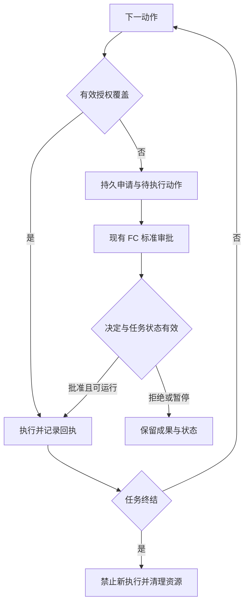
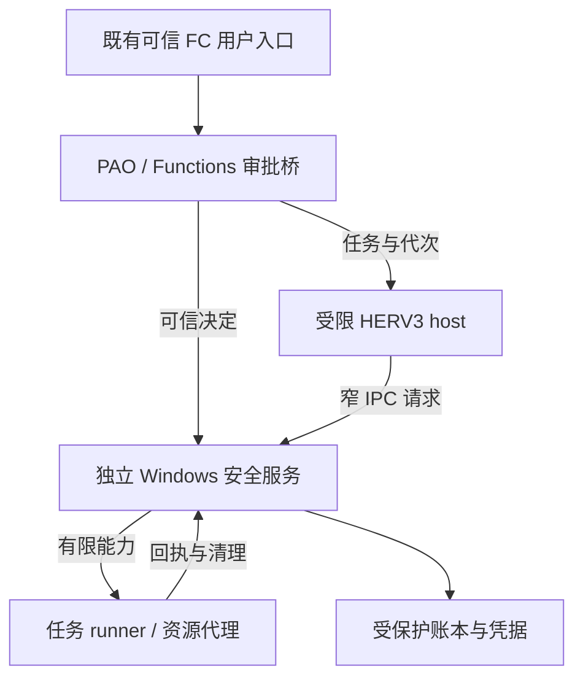

# HASHI 与 HERV3 权限系统产品需求文档

基本概念及 L1 L2 实现要求

版本 1.1 · 2026 年 10 月 23 日 · 已确定的产品设计，实施尚未完成

本文完整替代 v1.0 对本功能的描述。配套施工顺序见 [IMPLEMENTATION_PLAN](IMPLEMENTATION_PLAN.md)，源码落点见 [CODE_MAP](CODE_MAP.md)，交付事实见 [IMPLEMENTATION_STATUS](IMPLEMENTATION_STATUS.md)。**本分支正在实施，具体进度以实施状态为准；不表示权限功能已经上线。**

本次功能 owner 为 **PAO**，工程层为 **Functions / 平台独立服务**；HERV3 负责单循环内等待与续跑，FC 负责现有协议的投影和可信入口接线。FC 在本文始终指 **Frontend Connector**。验证重点为 L0 行为等价、FC 契约不变、授权生命周期和 Windows 执行边界。

本产品为每个 agent 建立可申请、可查看、可撤销的执行权限，并让临时权限随任务完成自动归还。HERV3 是完整实现的首要引擎；HASHI 负责统一管理、用户交互和后端能力说明。用户切换到无法完整管理的后端时，系统如实提示实际控制变化，并按用户选择继续工作。

本期交付 L1 的内部授权机制与 L2 的同机独立执行边界。L0 保持兼容；L3 仅预留接口。权限设计必须维护工作连续性：范围内自主执行，需要更多能力时主动询问，批准后恢复原步骤，任务结束即回收。

| 项目 | 定义 |
| --- | --- |
| 产品负责人 | Barry Li |
| 主要读者 | HASHI Functions / PAO / HERV3 开发者、Windows 服务开发者、实施与验收人员 |
| 实现重点 | 每 agent 权限、任务授权、HERV3 工具执行、生命周期回收、L2 Windows 原生隔离 |
| 源码基线 | Bazza1982/HASHI main，提交 d6b6513973bfc8f9f22c40ddd8f72802f907baa0 |
| 版本定位 | 可用于研发拆解和验收的需求基线；具体发布范围按能力验收结果确定 |

## 1 产品决策与交付范围

### 1.1 必须保持的产品行为

**BASE-01 自主工作与按需授权。**有效授权覆盖的动作直接执行。缺少权限时，HERV3 能说明用途并发起申请。系统保留上下文、已完成成果和待执行动作，批准后自动继续，避免要求用户重新描述任务。

**BASE-02 权限临时持有。**普通审批提供本次操作、本次运行、本任务和指定时长。临时权限始终归属一个任务，任务提前结束时提前失效。普通审批不提供永久持有选项；历史上曾被批准不构成下一任务的授权。

**BASE-03 不因后端兼容性禁止客户工作。**手动切换或用户预先配置允许的自动 fallback 遇到不支持完整权限控制的后端时，提示差异、更新实际状态并继续。不能把“不支持 L2”实现成全局禁止切换，也不能继续显示完整 L2 已生效。

**BASE-04 等级必须与实际边界对应。**L1 的控制由 HASHI 内部实施；L2 的授权权威与关键执行能力位于 agent 无权修改的独立操作系统权限域。另开进程、另建目录或加一个审批模型，均不足以单独达到 L2。

**BASE-05 复用现有结构。**保留 HERV3 的推理、工具注册、任务进度和现有生命周期；将权限作为统一执行服务接入。已有问答、工作区和设备控制机制保持各自语义，通过关联标识协作。

### 1.2 本期范围

本期包括 agent 安全配置、跨轮任务身份、权限申请及决定、临时授权账本、执行前校验、自动续跑、撤销和进程清理、后端能力状态、现有 FC 标准命令与交互消息的审批投影、审计记录、迁移和验收。L2 首个完整验收目标为 Windows 原生环境，不以 WSL 为前提。

第三方 CLI 的原生权限管理继续由其自身及实际运行环境决定。HASHI 只对自己确实掌握的执行通道作出承诺，不以改造第三方引擎作为 HERV3 上线的前置条件。

本期不实现 L3 跨机安全中心，不建立永久授权规则市场，不以另一个 LLM 的判断替代确定性的权限校验，不承诺防御已经取得本机管理员或内核控制权的攻击者，也不承诺撤销已经发出的数据或外部交易。

### 1.3 改动边界

**CORE-01 Core 不变。**不改 protected Core、其公开 envelope、启动协议或运行中 Core 的依赖。受保护路径的唯一来源是 `orchestrator.runtime_contract.CORE_SOURCE_PATHS`，不在本设计复制另一份路径名单。每个实现批次运行仓库既有保护检查；本任务不授权 Core major-version migration。

**CORE-02 改动限于 HASHI。**不改外部 Workbench、Telegram 客户端、其他外部前端，也不修改 Telegram 专用 connector、问答 adapter 或平台专属权限分支；共享 `/safety` handler 通过既有注册机制接入，认证修补限于公共 FC Functions。不新增审批专用公开 FC schema、字段、操作类型或 frontend widget。复用现有命令注册、标准菜单/action、普通消息、事件和快照。HASHI 中历史命名为 `orchestrator/workbench_api.py` 的文件属于 Backend API Functions；为既有入口接入认证和可信决定是允许的 HASHI 内部改动，不是修改外部 Workbench。

**CORE-03 单一权威。**PAO 持有 PermissionTask 和生命周期事实；PermissionService 持有权限账本。L1 服务在 Functions 中按需使用，L2 账本由独立服务持有，HASHI 保留投影。PCM、HERV3、FC 不各自写另一份授权真相。新共享服务经可替换 Functions 托管，不导入 Core；L2 新受限 host、broker 和依赖为独立安装单元。

### 1.4 成功标准

用户能够完成一次“缺权申请、批准、自动续跑、完成回收”的完整任务，无须重启会话。相同任务内有效权限不重复询问。L2 下，受限 HERV3 与脚本不能自行修改权限、批准自己或绕开受控执行入口。后端切换继续工作时，能力变化可见，原引擎的授权和清理状态仍可追踪。

## 2 现有实现与产品缺口

本节的现有事实以所列提交为准。后续章节规定目标行为，不将已有组件名称视为完整安全能力证明。

| 现有组件 | 已有基础 | 本期补充 |
| --- | --- | --- |
| ToolRegistry | 执行前检查工具白名单、请求范围与部分运行及 enterprise 规则 [C1] | 统一动作授权、可申请能力、原子用权、L1 与 L2 执行接口 |
| Workzone | 保存 agent 工作位置，投影到工具访问根 [C2] | 区分工作位置、基础授权和临时授权，避免批准写回永久配置 |
| RunQuestions | 普通问题绑定现有 Run；明确 `grants_permissions=False` [C3] | 语义不变；独立权限实体通过 `/safety` 标准 FC 命令展示，不能把问答 answer 当批准 |
| FC command registry / interactions | 自动发现 RuntimeCommand/Callback，已有 catalogue/open/act/close 与 opaque menu/action 绑定 [C11][C12] | 增加 `/safety`，持久申请和服务端可信决定；MenuStore 只作短期展示缓存 |
| HERV3 活动路径 | `Stage.DIRECT` 进入 provider adapter 的连续工具循环 [C13] | 接入真实活动路径，不只改旧 coordinator / Stage.EXECUTION wrapper |
| HERTaskState | 一个 HER Turn 内共享的认知状态，每次 run_turn 创建 [C4] | 跨 turn 的 PermissionTask，不能把现有状态直接当长期授权任务 |
| HERV3 恢复逻辑 | 重启时处理旧的运行中 ledger，不重建执行栈 [C5] | 待执行动作的持久化、安全恢复和副作用对账 |
| Agent 生命周期 | worker 启停、quiesce 和关闭路由 [C6] | 在停止流程前使权限失效，再独立确认资源清理结果 |
| CapabilityBroker | 设备归属、互斥控制及带时限的 lease [C7] | 人类权限与设备占用分别校验，撤权联动释放设备 |
| Enterprise policy | allow、deny、approval_required；personal 路径及无匹配规则可直接允许 [C8] | 权限系统独立于部署档案启用，审批记录与执行租约分离 |
| Shell 执行 | 启动本地进程，设置工作目录、超时和可选命令模式检查 [C9] | 按动作申明资源；需要强制目录和网络限制时使用受限执行器 |
| Privacy levels | 独立处理隐私等级及后端适用性 [C10] | 与权限系统协调数据出口，不合并为一个含糊等级 |

## 3 基本概念和权威关系

### 3.1 核心对象

| 对象 | 产品含义 |
| --- | --- |
| Owner | 有权批准权限、调整策略和选择后端的人类用户 |
| Agent | 持续存在的执行主体；身份由可信运行层绑定，不接受模型自报作为凭据 |
| Session | 对话容器；保存交流，不自动赋予会话中全部历史权限 |
| PermissionTask | 有明确用户目标和结束条件的权限任务，可跨多个 turn 和 run |
| Run | PAO 接纳一个用户 Message 后的一次执行；沿用现有 PAO 定义，不能等同进程实例 |
| ExecutionEpoch | 权限服务为当前可执行绑定颁发的代次；worker 替换、backend 切换、恢复时重新绑定，Run 可保持不变 |
| Turn | 一次 HERV3 对话推理轮次；沿用现有引擎定义 |
| Operation | 一次可执行动作，具有稳定 operation_id、资源和参数摘要 |
| AccessRequest | agent 或执行入口提出的权限申请；本身不赋予权限 |
| ApprovalDecision | 可信用户针对特定申请版本作出的决定 |
| PermissionLease | 在确定主体、任务、资源、动作和期限内可用的权限租约 |
| ExecutionTicket | 服务内部或受保护通道中的短期执行凭证；不等同长期批准记录 |
| ResourceBinding | 操作实际涉及的文件、目录、网络目标、凭证或设备绑定 |
| ControlLease | 现有设备互斥或控制归属；获得设备占用不代表已获人类授权 |
| EffectiveControl | 当前引擎、执行器、平台和健康状态实际能够落实的控制 |

### 3.2 任务与运行的关系

**TASK-01 跨轮任务。**新增持久 permission_task_id，绑定 owner、agent、目标摘要和终结条件。一个任务可以包含多个 run；同一 agent 的并行任务分别持有权限。已有 HERTaskState 继续服务单轮认知，不承担权限账本职责。`run_id`、`worker_generation`、`context_generation`、`execution_epoch`、`task_revision` 与 `policy_revision` 各有独立含义，不用一个 generation 混代全部概念；批准事件不是新的用户 Message，也不伪造新 Run 来继续原操作。

**TASK-02 任务归属。**运行管理器决定新消息是补充当前未完成任务，还是启动新任务。明确的补充、等待后的继续和恢复关联原任务；已完成任务后的新增工作建立新任务。目标发生实质变化时更新任务或创建任务，不能借“继续”继承不相关权限。模型可提出建议，不能自行变更授权归属。

**TASK-03 完成判定。**模型报告完成后，运行管理器核对待执行动作、后台任务、子任务和交付状态，生成可信终结事件。没有未完工作且成果已提交时可以自动完成，无须每个任务额外让用户点“结束”。只有仍属于本任务的必要业务工作可以使任务保持开放，并须有可见状态和有限授权期限。已独立获批的后台任务不阻止父任务完成；资源清理残留或清理失败不延长业务授权。

### 3.3 权限如何组合

一次动作可执行的必要条件为：主体和任务有效、能力在用户可授予范围内、有效基础配置或租约覆盖该动作、现行限制得到满足、执行器能落实当前声明的边界。多个来源的权限只在同一主体和适用任务内组合，不能借用其他任务、其他 agent 或历史会话的授权。

基础配置表达用户明确选择的长期工作习惯，例如 agent 自有工作目录和已指定的常用工作区。临时审批只能产生任务租约，不能自动修改基础配置。设置界面修改基础配置属于独立的用户管理动作，应显示它会影响后续任务。

L1 中，上述管理代码和账本仍处于 HASHI 信任范围。L2 中，它们的最终权威移到独立安全服务；HASHI 可以保留缓存和界面投影，但不能用本地副本覆盖服务决定。

## 4 安全等级与实际控制状态

### 4.1 等级定义

| 等级 | 授权和执行的边界 | 产品承诺 |
| --- | --- | --- |
| L0 | 直接走既有执行分支，不创建新权限服务或租约 | 保持既有工作行为、工具和生命周期；既有防护继续生效 |
| L1 | HASHI 内统一授权和执行检查 | 受管理动作按权限执行；保证申请、期限与回收语义；不声称对 HASHI 自身被篡改具有独立防护 |
| L2 | 同机独立安全服务和受限执行环境 | 在已验收平台及通道上阻止 agent 修改授权权威、冒充审批和直接越界执行 |
| L3 | 远端授权权威与受保护执行端 | 预留；本期不显示为可启用能力 |

L2 延续 L1 的用户体验和授权语义，增强权威和执行隔离。它不是要求每次动作多点一次确认。

### 4.2 设置等级与实际覆盖分别显示

**LEVEL-01** 同时保存 requested_level、backend_id、executor_profile、capability_revision 和 actual_controls。实际控制至少拆为文件访问、脚本执行、网络出口、凭证使用、设备控制、可信审批和撤销清理。能力报告由实际安全服务、平台适配器及启动验证生成，绑定服务代次、执行器版本和观测时间，不能由模型自报或仅根据设置等级推导。

**LEVEL-02** 每项实际控制使用 enforced、partial、unmanaged、unavailable、unknown 等明确状态，并附原因。L1 的内部强制检查与 L2 的 OS 隔离应分别标明执行层级。报告过期、服务失联或执行器被更换时，不能沿用旧的 enforced 标签；无法验证的第三方原生通道使用 unmanaged 或 unknown。能力之间存在依赖时，一项边界失效须同步反映到依赖它的控制，不能简单取一个数字掩盖关键缺口。

**LEVEL-03** “L2 已生效”只适用于当前活动任务所用路径均通过 L2 验收且服务健康的情况。第三方原生工具、未隔离桌面控制或临时宽权限例外启用时，保留用户设定等级，同时将实际状态改为部分受控。

### 4.3 兼容性与缺权是不同流程

后端不支持某等级时，采用提示并继续的兼容流程。HERV3 中某个具体动作缺少权限时，采用申请并续跑流程。安全服务故障时，不把“没有得到授权结果”当作批准；当前依赖服务的动作等待，其他工作可以继续，用户也可以选择兼容后端。状态必须随选择更新。

### 4.4 L0 必须是真正的兼容路径

**LEG-01 默认无迁移。**旧配置缺少安全字段时按 L0 读取，不回写新默认。新建 agent 只有通过用户明确选择才启用 L1/L2；可推荐 L1，但未作选择仍为 L0。不静默限制旧 workzone、工具或 fallback。

**LEG-02 无新依赖。**L0 在最外层选择原执行分支；不通过 PermissionService 的 allow-all 模式实现兼容。不创建权限数据库、task/epoch、租约、守护线程、服务连接或额外恢复步骤。独立 L2 服务停机或权限数据库损坏不影响 L0。

**LEG-03 模型行为不变。**L0 保持原工具目录、工具 schema、system prompt、注入上下文、重试/超时/完成语义；不注入 request_access 工具或安全提醒。不承诺随机模型逐字相同，而应证明确定性输入、调用路径和可观察行为一致。

**LEG-04 既有规则保留。**L0 不取消当前 privacy、enterprise、工具白名单、workzone、设备互斥和后端自有规则。新系统只退出自己的执行路径，不把 L0 解释为关闭既有所有安全机制。

**LEG-05 多等级隔离。**L2 安装不改普通 HASHI 用户的全局 ACL、进程环境、网络代理或共享凭据使用方式。L0 不被放进 L2 runner；多个 agent 的模式与授权独立。

**LEG-06 主动降级。**由可信用户选择切回 L0 时，先阻止原受控路径新执行，再清理或对账旧 operation，保留已完成成果；独立工作可继续。旧执行未知时不得重放同一副作用。降级后展示真实覆盖，不把清理失败写成成功。

**LEG-07 可验证等价。**以冻结源码基线作比较，覆盖配置无字段、显式 L0、权限服务不可用、冷热启动、prompt/schema、文件/shell、后台/子 agent、超时/取消和后端选择。不能只测新代码自己返回 allowed。

**LEG-08 混合部署诚实。**若同机 L0 agent 能取得 L2 人类审批凭据或控制审批桌面，L2 不能显示完整可信审批。优先隔离 L2 控制平面；无法隔离时报告 partial，不能为维持 L2 标签悄悄改变 L0。

## 5 权限范围和资源模型

### 5.1 按能力和动作表达权限

| 资源类别 | 至少区分的动作 | 授权边界示例 |
| --- | --- | --- |
| 文件与目录 | list、read、create、modify、delete、move | 某目录只读，或只允许写入任务输出目录 |
| 执行环境 | run_process、run_script、install_dependency | 指定执行器、输入目录、输出目录和网络范围 |
| 网络 | connect、fetch、upload、listen | 指定域名或服务、协议和端口；上传与读取分别声明 |
| 凭证 | use_credential | 由代理服务使用指定凭证完成指定操作，不向模型返回原始密钥 |
| 浏览器与桌面 | inspect、interact、upload、submit | 受控浏览器实例、站点或设备会话及其可落实范围 |
| 外部业务动作 | send_message、publish、commit、delete_remote | 明确目标账户、收件人或仓库，以及具体动作 |
| 任务与委派 | start_background、delegate | 当前任务所需子能力，限定归属和期限 |
| 管理操作 | approve、revoke、change_policy、change_level | 仅可信用户管理入口可调用 |

**SCOPE-01** 工具名称只表示入口。批准 shell、browser 或某 connector 不能默认放开其全部副作用。工具适配器须声明所需动作与资源；多能力动作只有全部必要权限满足后才能执行。

**SCOPE-02** 能力目录、可申请范围和当前有效权限分别保存。工具未获授权时仍能被 agent 发现并申请；明确不提供的能力返回不可用或用户策略禁止。不能为了让模型“看不到”而阻断其正常申请路径。

**SCOPE-03** 新增工具必须具有权限描述和回收契约。未知工具的副作用能力不能凭旧的通配符静默获得授权；兼容 L0 的行为单独保留。用户可授予的上限由管理配置决定，agent 只能请求调整，不能自行扩展。

### 5.2 Workzone 的含义

/workzone 继续用于选择工作位置、搜索偏好和常用资源。选择一个目录时，界面明确它仅作为位置提示，还是用户同时授予基础访问。临时访问批准不改变 /workzone 的永久配置。

**SCOPE-04** 经受管理文件适配器发起的每次访问，都重新使用当前可信范围判断；脚本内文件访问按 runner 的实际约束能力报告。相对路径以获批工作目录解析；检查真实对象，覆盖父目录跳转、符号链接、Windows junction 或 reparse point、UNC、盘符别名及大小写。新建文件需核验目标父目录和实际创建位置。受管理文件工具和 L2 runner 的验收须覆盖校验后路径被替换的竞态，不将 L1 已披露的无约束 shell 例外宣称为 OS 围栏。

**SCOPE-05** 更改工作区路径或权限版本时，旧租约不自动迁移到新资源。若新目录已在同一有效授权内可以直接继续；否则只申请新增范围。撤销必须影响随后的动作，不能等待普通 workzone 配置在空闲边界刷新。

### 5.3 Shell 和复合工具

**SCOPE-06** 为脚本构造明确的执行描述：命令或脚本摘要、运行器、工作目录、只读输入、可写输出、允许网络目标、所需凭证和生命周期。用户批准的是实际资源范围和必要动作，不把无法可靠解析的命令文本当作权限范围证明。

L1 可使用 HASHI 管理的受限 runner 落实脚本资源范围；控制代码仍属于 HASHI。若当前平台只有无约束的本机 shell，必须明确该动作无法保持目录或网络围栏。用户仍可以批准明确展示的宽权限例外，但界面和回执要标记覆盖下降，不能声称这次 shell 仍受严格 workzone 约束。

L2 的脚本必须进入已验证的受限执行器。若当前 runner 不兼容，可提供另一执行器、结构化工具或用户选择的兼容后端，保留任务进度。不能在服务内部悄悄改用高权限 shell。

### 5.4 数据读取与对外传输

**SCOPE-07** 文件读取权限不自动包含发送、上传或任意网络出口。由于模型分析可能需要把内容交给已选 provider，任务界面应一次说明分析位置及适用 /privacy 策略；同一已授权任务不必逐文件重复询问。结构化 fetch 或 upload 工具可以分别授权；任意脚本取得网络连接后，仅靠域名或 HTTP 方法限制无法证明禁止数据外传。不能落实这种区分的通道，应在审批中说明其对外发送能力，并将上传控制标为 partial。

已有隐私要求和明确的数据接收方限制继续生效。切换后端时，不能只凭“兼容性允许继续”就把原本限定本地处理的数据发给新的云端。可继续不依赖该数据的工作，或为新的数据去向提出具体申请。

本期按资源、操作、执行环境和已知数据出口实施控制，不宣称能够识别所有语义泄露或隐蔽通道。读取后已经进入模型上下文、会话或交付文件的内容，不会因撤销文件访问自动消失；内容保存与清理由 /privacy 和既有数据管理负责。

## 6 临时授权的期限与使用规则

### 6.1 用户可选择的期限

| 选项 | 绑定范围 | 失效条件 |
| --- | --- | --- |
| 本次操作 | agent、task、operation 和参数摘要 | 操作结算、取消或期限到达 |
| 本次运行 | agent、task、run | Run 结束，或任务先结束、撤销、期限到达 |
| 本任务 | agent、permission_task_id | 任务完成、取消、终止性失败、撤销或上限到达 |
| X 小时 | agent、task 和 expires_at | 指定时间到达，或任务先结束、撤销 |

**LEASE-01** 默认突出“本任务”，并清楚展示最长有效期。建议初始默认上限为 4 小时，用户可改；这是产品默认值，不是不可调整的硬限制。超过上限的长期任务可按需续期，系统不能因任务仍在运行就自行延长批准期限。首次迁移和设置页可调整默认时长。

**LEASE-02** 每次授权的实际可用期由任务结束、用户期限、撤销及必要父授权的最早失效事件决定。只有绑定本次 Run 的授权随 Run 结束失效；本任务和 X 小时授权可跨 Run 保留，旧执行凭证失效后按当前状态重新签发。相对时长从可信批准事务提交时起算，用户选择的绝对截止时间不顺延。申请展示所选期限规则，批准后展示准确截止时间；界面使用用户时区，权威账本使用 UTC，运行内计时采用能抵御时钟回拨的机制。审批卡自身的等待有效期与授权时长分别计算。

**LEASE-03** 权限批准存成不可静默改写的决定；后续执行由可撤销租约及短期执行凭证驱动。长任务在批准期限内可自动取得新执行凭证，不需要重复人工批准，也不得借刷新凭证延长原批准。

### 6.2 单次授权与重试

**LEASE-04** 单次操作绑定 operation_id 和关键参数摘要。执行服务在同一原子事务内验证身份、任务、期限、策略版本和使用状态，再预占额度。两个并发调用不能同时消费同一批准。

预检查不消耗额度。能证明执行尚未开始的准备失败，可以释放预占；已开始产生副作用则进入执行中或待对账状态。已成功动作的传输重试返回原回执。外部结果未知时，先查证结果，不将超时直接转化为第二次发送、提交或写入。

### 6.3 授权不会随上下文复制

**LEASE-05** 会话复制、分支、agent 克隆、导入历史对话、工作区移动和换 owner 不复制活动租约。内容可以按既有规则复制，权威授权要针对新的执行主体重新建立。

**LEASE-06** 多个并行任务分别计算权限。任务 A 的只读目录和任务 B 的可写目录，不得因同一个 agent、同一个 Windows 账户或同一模型会话而合并到两个任务的执行环境中。

## 7 申请审批与无缝续跑

### 7.1 正常工作流程

1. HERV3 了解可用能力及当前任务授权，规划下一步。
2. 已知需要新增资源时调用 request_access；执行入口发现缺权时也生成同类申请。
3. 系统记录申请、真实资源、动作、理由、期限和恢复位置。主动规划申请可以尚无 PendingOperation；被执行入口拦下的动作必须绑定 operation_id 与参数摘要。缺权步骤进入等待，其他无依赖工作仍可继续。
4. 用户在现有 FC 的标准 `/safety` 消息和 action 中批准、收窄、拒绝或稍后处理；不要求新增专用面板。
5. 批准记录形成租约；PAO 核验任务状态、execution_epoch、worker/context generation、当前后端及申请内容。可运行时，规划申请恢复规划，被拦动作恢复同一 operation；已暂停任务保留批准但不自动开跑，已取消任务不恢复，后端已切换时不唤醒旧引擎。
6. 后续范围内工作直接进行；任务结算触发回收并更新界面。



### 7.2 申请体验要求

**UX-01 明确表达。**普通申请消息至少说明哪个 agent、为哪个任务、为什么需要、访问什么、做什么、何时归还。技术 ID、参数摘要和执行器详情通过既有详情、分页或文本命令按需查看，不要求新折叠控件。资源和理由分开呈现，资源由系统解析，不完全依赖模型生成的说明文字。

**UX-02 合并与去重。**同一 agent、task、规范化资源、动作和申请版本的重复需求合并。可预见且相关的多个资源放入同一卡片，用户可以批准部分项目。只合并需求，不扩大资源到共同父目录，不把读写自动合并为所有权限。

**UX-03 已有批准直接复用。**有效租约已覆盖时返回 granted_existing；网络重连、再次展示卡片、相同工具重试和跨 turn 继续不重复打扰。新资源、更高权限、新接收方或失效租约才提出增量申请。

**UX-04 等待不中断成果。**等待权限的步骤暂停；其他已授权且无依赖的步骤可继续。若当前 HERV3 任务没有可独立进行的工作，则保存进度等待，不为表现“继续工作”而创建新任务或绕过授权。

**UX-05 等待不消耗无效推理。**使用事件驱动唤醒，不让模型不断调用工具轮询。WAITING_PERMISSION 不计为死循环、无进展、工具故障或普通执行超时；Agent Companion 及重试机制显示“等待用户授权”，不重复重启任务。

**UX-06 拒绝后仍能合作。**拒绝只限制相关能力；系统保留成果，说明受影响步骤，允许用户提供文件、缩小范围或选择替代路径。条件未改变的同一被拒申请不反复提交，用户明确要求时可以重提。范围实质缩小、资源改变或必要条件变化时，agent 可以主动发起新申请并说明差异，无须先问是否允许提出申请。审批卡过期但需求仍有效时，也可基于原任务重提，用户不必重写任务。

### 7.3 审批的可信来源

**APPROVAL-01** 普通 ask_user 的 clarification 或 preference 回答不生成权限。权限批准必须指向明确的 request_id、request_revision、选择范围和期限，经受信任的人类入口提交。

**APPROVAL-02** 第一版的正式批准入口为可信 FC `/safety` 命令与其服务器签发的 action。自然语言可以引导到准确申请并展示可点击动作或完整可复制命令；不让 LLM 把“好的”“继续”解析为权限写入。引用、转发、工具结果、网页指令和模型生成的“用户同意”均不构成批准。精确命令或 action 本身已经足够明确时，不加第二次确认。

**APPROVAL-03** 提交决定时，系统重新校验已认证 principal、owner、任务状态、request_revision、scope_digest、原始请求绑定、nonce 和期限；幂等重投只返回原决定。已取消任务的旧卡片不能重新授予权限。申请范围发生变化时，原决定不自动覆盖新版本；范围缩小且仍被原批准包含的动作可复用原租约。

**APPROVAL-04** 服务端新增可信 Principal / DecisionReceipt，只有认证入口能生成；actor_id、配置 owner、localhost、客户端自报 allowed 或共享 token 本身不证明人类。L2 中，批准身份、签名密钥、Telegram/Remote 凭据和审批浏览器会话均须使 agent 无法取得或控制。现有 FC 不具备认证能力时，普通工作继续，可通过另一已连接可信 FC 处理同一申请；该入口不接受授权写入。不能伪造 owner 来满足“前端不改”的约束。

## 8 生命周期回收和故障恢复

### 8.1 任务状态和权限状态分别维护

| 事件或状态 | 权限与执行行为 |
| --- | --- |
| active | 按有效授权执行；仅为新增范围申请 |
| waiting_permission | 缺权动作等待；既有授权按原期限保留；可以继续独立工作 |
| paused | 冻结新操作；保存任务和批准依据；按工具能力暂停或停止在途执行 |
| recovering | 对账旧操作与资源；确认有效批准后重新签发凭证 |
| completed | 立即使任务临时权限不可用于新操作，再清理执行资源 |
| cancelled | 取消申请、撤销租约及派生授权，停止或清理关联执行 |
| failed | 仅终止性失败结束任务并回收；可恢复错误保留任务，按原期限校验 |
| expiry 或人工撤销 | 立即拒绝新用权；中止或受控收尾相关在途动作，展示回收状态 |

租约使用 active、suspended、consumed、expired、revoked 等状态。执行资源另外记录 running、stopping、stopped、cleanup_failed、unknown。不得用一个 revoked 字段同时代表新请求已禁止和所有进程已经停止。

### 8.2 任务完成与在途动作

**LIFE-01** 终结事件先更新权威授权版本并禁止新操作，再清理进程、句柄、网络连接、设备控制和会话凭证。即使 worker 的 quiesce 失败，也不能让任务权限继续生效。清理完成后才显示“全部回收完成”。

**LIFE-02** 每种工具声明取消能力和结算方式。可取消动作及时停止；原子提交已完成时保留结果；不可确认的外部操作标记结果未知并进行对账。清理只能使用服务自身的有限清理能力，不能给 agent 延长业务权限。

**LIFE-03** 用户界面分别显示“权限已撤销”“执行正在停止”“停止失败或未知”。成果可先交付，清理状态随后更新，不因清理较慢隐藏已有结果。撤权不表示文件变更已回滚，也不表示数据已从模型上下文删除。

### 8.3 暂停和恢复

**LIFE-04** 暂停不等于任务完成。暂停后冻结用权，并使活动执行凭证失效或暂停；批准记录在原期限内可保留。恢复时校验身份、任务、资源和权限版本，范围未变且批准未过期则直接续跑，只有缺失部分才重新申请。

**LIFE-05** 用户停止 agent 时，终止其活动运行和任务授权，取消等待申请；后续启动 agent 只恢复可用状态，不自动重启被用户停止的工作。检查点和成果可保留，用户明确续做时重新核验所需权限。普通界面断连不等于停止 agent；手机切到后台、浏览器关闭或网络暂断，不应自动把正常工作的任务标为完成，但任务仍受原期限约束。意外崩溃按恢复流程处理，不混同于用户主动停止。

### 8.4 重启与未知副作用

**LIFE-06** 持久化待执行 operation、参数摘要、批准关联、回执、任务归属和恢复位置。新的可执行绑定获得独立 execution_epoch；worker_generation 和 context_generation 沿用各自现有定义。旧实例票据不得继续使用；未到期的任务批准可在可信核验后重新签发，避免重启必然要求再批准。退出事件只回收退出的 worker_generation / execution_epoch，不得按 agent 名清空已经启动的新代次；候选 worker 失败同理。

**LIFE-07** 不重放整个执行栈。恢复时将动作分为尚未开始、已完成、结果未知；分别继续、复用回执或先对账。已撤销和已过期批准不得因数据库恢复、系统时间回拨或重启而复活。正常服务重启可核验并保留有效批准；恢复旧备份须进入恢复模式，依据独立保存的恢复 epoch 或撤销日志核验。缺乏可靠依据时，使备份中的活动授权失效，保留成果与历史，仅为仍需访问的范围重新申请；不能只换 generation 就重新签发旧批准。

### 8.5 后台任务和子 agent

**LIFE-08** 子 agent 取得父任务必要权限的子集，并保存来源和依赖关系。父授权撤销时，依赖它的派生授权同时失效。需要新增权限可以发起申请；用户直接批准的独立授权须有独立任务与明确归属，不能冒充继承。

**LIFE-09** 后台进程属于某个 task、operation 和 executor。前台任务结束时，其后台进程不能隐身延续。用户确实要求后台继续时，先建立可见的独立后台任务及相应期限；定时或延迟启动时再次验证权限。

**LIFE-10** 删除或归档 agent 时，先完成授权回收和运行资源处置，再移除活动身份。保留最小审计记录，不因删除界面卡片丢失未完成清理的追踪信息。

## 9 L1 实现需求

### 9.1 组成和执行位置

L1 在 HASHI 内提供统一 PermissionService。ToolRegistry 在预检查阶段取得是否需要申请的结果，在实际 dispatch 前进行原子授权验证。HERV3 runtime 处理等待和续跑；可信运行管理层维护 PermissionTask；前端只提交用户选择，不自行判断权限是否有效。

**L1-01 服务接口一致。**申请、批准、检查、用权、撤销和查询采用稳定接口。L1 使用 Functions 域实现，L2 使用独立服务客户端；同一进程直接调用，跨 Functions 进程复用既有 envelope 路由。业务工具不直接读取某个本地 JSON 后自行决定允许执行。

**L1-02 覆盖所有副作用入口。**文件、shell、网络、浏览器、桌面、外部连接器、模型出口、后台任务和委派分别登记。HERV3 内置工具、自定义 skill 的执行工具及重试路径不能绕过统一检查。没有权限描述的入口必须明确显示覆盖不足。

**L1-03 区分决定结果。**至少返回 allowed、approval_required、denied、unavailable 和 execution_unknown。approval_required 属于可恢复流程，不作为普通工具错误反复重试；denied 也不触发切换后端来规避。

**L1-04 无副作用预检查。**现有同步 evaluate_admission 保留静态旧检查；需要权威 I/O 的权限 evaluate 放在异步 execute 中紧随旧 admission，不把原同步接口改成阻塞 RPC。查询权限不创建执行、不消费次数。当前 Registry admission 发生在 execution_resources 排队之前；新增的原子 claim 必须发生在资源等待结束、实际 dispatch 之前，再核验期限、撤销、任务和 epoch。等待人类时释放资源锁；仅预先拿到票据不能绕过排队期间的撤权。

**L1-05 独立持久记录。**申请、批准、租约、操作回执和事件在同一权限域内事务性维护。与现有 PAO、session、run 数据以 ID 关联，不将可修改的模型消息当作权威账本。

**L1-06 不污染基础配置。**临时批准不修改 agent 的 allowed_tools、workzone、系统环境变量或永久 credential 配置。任务结束后不需要依靠 agent 自觉删文件才能恢复限制。

**L1-07 运行上下文可信注入。**owner、agent、task、run、execution_epoch 及各代次由可信 PAO 运行层提供；工具参数只能声明期望资源及理由。禁止模型通过参数指定其他 agent 的授权身份。

**L1-08 审批等待可恢复。**新增内部 PermissionWait / PendingOperation，`waiting_permission` 是任务内部子状态，不扩展公开 FC Run status/schema。区分恢复规划和恢复具体 operation。复用 HERV3 连续循环的等待模式，不能仅修改旧 Stage.EXECUTION wrapper；不能把缺权编码为普通 is_error 触发 stall/fallback。唤醒核验内容摘要、任务、执行代次和后端，晚批准不覆盖暂停、停止或切换。等待须能持久化 park，使 Functions quiesce/hot adoption 正常排空；采用后依据回执恢复，不重放整段模型推理。部分批准只恢复满足全部必要范围的动作。

**L1-09 personal 同样生效。**只要用户启用 L1，新权限检查就执行，不因 enterprise policy 的 personal 快捷路径而跳过。已有 enterprise 明确限制继续参与判断，普通临时批准不能自行越过用户无法更改的上限。

**L1-10 内部保护范围诚实。**保护配置文件免被常规文件工具修改，审批 API 不向 agent 授予，但 L1 仍不声称抵抗拥有足够本机权限的任意代码篡改。需要独立防篡改保证的用户使用已验收 L2。此限制在等级说明中一次说明，不为每个正常动作反复弹窗。

### 9.2 L1 上线的最小闭环

必须同时具备结构化权限申请、可信批准、有效租约、执行前校验、批准后续跑、完成回收和实际能力显示，才能发布 L1。只有 UI 卡片、提示词或一个可编辑的权限 JSON，不能单独作为 L1 功能交付。

## 10 L2 同机独立安全服务需求

### 10.1 信任边界

L2 将授权权威、审批身份验证、策略库、关键凭证及受控执行移到独立安全服务。HERV3 的请求、脚本、模型输出和工具结果均作为待验证输入。服务使用与 agent 不同的操作系统权限域；agent 只能调用被授予的申请、查询和执行接口。

推荐拓扑保持现有 Core / PAO Functions 宿主作为可信控制平面；在 Functions / adapter 边界新增受限 HERV3 execution host，完整模型循环与工具请求在受限身份中执行。独立服务持有权威账本，窄 broker 只提供已授权的模型调用与资源动作。现有普通 multiprocessing worker 和宽 Functions RPC pipe 不能直接充当 L2 沙箱；受限 host 不获得其句柄或管理凭据。具体组件、安装和验证见 [L2_WINDOWS](L2_WINDOWS.md)。



**L2-01 独立安装与保护。**服务代码、依赖、配置、账本和密钥安装在 agent 无写权限的位置，不放在其可编辑 workzone。agent 无权停止、重配置、替换或卸载服务，也无权修改这些对象的 ACL。Windows 服务的停止和配置修改权限可以分别控制，应按最小权限配置。[M1]

**L2-02 不让高权限服务执行任意代码。**服务可验证请求、签发有限票据并执行经过定义的代理动作；任意 shell 和脚本进入低权限 runner。不得把用户批准理解成把完整管理员 token 交给 agent，或在 LocalSystem 进程中直接运行模型生成命令。

**L2-03 替换真实执行路径。**ToolRegistry 的受保护动作在 L2 下改为服务调用。HERV3 和插件不能仍保留另一条直接读取受保护目录、连接任意网络或使用原始凭证的路径。安全服务内部再次校验身份与授权，不信任 HASHI 发来的 approved=true。

### 10.2 Windows 原生执行环境

**L2-04 验证受限 runner。**首期优先验证 AppContainer 或 LPAC 等 Windows 原生隔离方案；它们通过 SID、token 和 DACL 等机制限制资源访问。[M2] 具体选择由兼容性验证决定，必须满足本 PRD 的文件、网络、进程和审批隔离要求，不能仅凭技术名称通过验收。

CreateRestrictedToken 可移除 privileges、禁用 SID 或增加限制 SID，但仍需配合完整资源控制。[M3] 若目标程序不兼容首选 runner，可以提供另一种经过相同验收的受限执行器。同机 VM 可作为可选实现；它属于 L2，且不要求使用 WSL。

**L2-05 按任务隔离资源。**代理文件操作、每任务执行身份或容器、受限句柄传递均可作为实现方式。不得给所有 agent 共用账户不断增加目录 ACL 来表达临时授权，避免并行任务权限并集。任务 A 的执行器不能取得任务 B 的有效凭证、句柄或目录能力。

**L2-06 管理整个执行生命周期。**runner 在业务代码开始前进入受管理进程组，并记录 task 和 operation 归属。Windows Job Object 用于进程树管理与清理，不代替文件、网络或身份隔离；现代 Windows 的相关安全限制需要逐进程落实。[M4] 通过系统调度、服务创建或其他机制逃离普通子进程树的行为也必须受策略控制。

### 10.3 通信和用户批准

**L2-07 受保护 IPC。**Windows 可使用显式 ACL 的 named pipe 或具有等效身份验证的本地通道。不能以 localhost、PID 或 JSON 中的 agent_id 作为充分身份依据。连接必须绑定受信任的运行实例和其可代表的任务；named pipe 的默认 ACL 不能直接作为产品最小权限配置。[M5]

**L2-08 分离执行与审批身份。**agent 接口仅允许申请、查询、撤回自身申请及提交受限执行请求。approve、change_policy 和 change_level 使用独立用户身份。HASHI Functions 不得成为从 agent 宽 RPC 转发到人类审批或无限制工具执行的代理；服务验证连接的受限身份、允许方法、对象绑定、决定来源和防重放信息。Core 无需理解权限业务或扩展协议。

**L2-09 抵御自身界面操作。**浏览器与桌面控制不得操作本人的审批页面、读取审批会话凭证或调用批准接口。文件路径黑名单不足以解决同一桌面的自批问题；L2 桌面控制需要隔离会话、隔离审批客户端或人类存在验证。无法满足时，该通道显示部分受控，用户仍可选择使用。若该通道能够操作审批或更改策略，可信审批及依赖它的 L2 授权保证也同步标为不足，不能只改变桌面通道一项标签。

### 10.4 网络凭证与资源撤销

**L2-10 网络出口独立控制。**受限 runner 默认不取得任意网络访问；获批目标通过可实施的出口代理或 OS 限制落实。需覆盖 DNS 变化、直接 IP、重定向、代理配置、localhost 和 LAN 服务。允许调用局域网模型服务不等于允许访问整个局域网。目的地受限不等于只读网络；任意脚本的获批连接应披露所含发送能力，无法落实独立上传控制时按 SCOPE-07 展示。

**L2-11 凭证按动作使用。**原始业务密钥由安全服务或独立凭证代理持有，按目标和操作使用。传给执行器的只应是必要且可限制的能力；避免把广泛凭证放入所有子进程继承的环境。工具输出和审计日志不得回传可复用 secret。

**L2-12 回收存活能力。**撤销时禁止新操作，并使相关票据、句柄、连接、设备会话与执行器失效或停止。删除账本行、撤销目录 ACL 或设置 expires_at 都不足以单独证明已经打开的资源已停止使用。清理超时按真实状态告知，不能显示回收成功。

### 10.5 服务健康和能力发布

**L2-13 服务故障不伪装成功。**不能因 RPC 失败就走无约束本地执行。依赖该服务的动作进入等待或恢复状态，其余工作和已完成成果仍可使用。用户可手动或按既定 fallback 选择其他后端，系统说明能力变化后继续。

**L2-14 重启有边界。**服务恢复时换新运行代次，对账活动票据和 runner，先处理孤儿执行再接受恢复动作。验证未到期批准后可恢复任务；不把磁盘中的旧活动标记直接当成有效执行凭证。服务失联或批准到期后的停止由可信监督进程或 OS 生命周期机制执行，不依赖 agent 自行遵守，也不依赖审批界面保持打开。

**L2-15 按平台和通道验收。**Windows、Linux、macOS 各自维护能力矩阵。首期完整发布 Windows 已验证组合；其他平台和未完成的浏览器、桌面路径如实标记。增加一个 runner 或升级关键隔离依赖后，重新验证对应能力，不凭版本继承“完整 L2”。

## 11 后端切换与工作连续性

### 11.1 切换时的行为

**BACKEND-01** 手动切换和已配置自动 fallback 都生成 backend_changed 事件，计算当前 task 的实际控制变化。仅当变化有实质影响时出现一次说明；状态标识持续存在，详细能力按需展开。

**BACKEND-02** 用户的后端选择继续生效。安全能力不足本身不产生禁止切换的门槛，也不增加每次运行都要点击的确认。提示不得含糊地说“安全性下降”，应说明目录限制、到期回收或原生工具控制中的具体缺口。

示例文案：当前已切换到所选后端。HASHI 仍管理自己的工具，但无法完整约束该后端的原生文件与进程操作。任务继续，当前状态为部分受控。

### 11.2 切换前后授权如何处理

**BACKEND-03** 原后端的活动票据失效，活动操作按自身能力停止或对账。有效的任务批准记录可以保留给后续受控执行，但不把原始密钥、管理员身份或扩大后的文件访问配置复制给新后端。新后端继承稳定 operation_id 与回执状态；旧后端已发送或提交而结果未知时，不把它当成全新动作再次执行，可以继续独立步骤并对账原结果。

外部后端仍调用 HASHI 管理的工具时，这些调用继续执行相应权限规则。外部后端的原生工具按实际能力报告；无法观察到的活动不得显示为已完成回收。

**BACKEND-04** 切回 HERV3 时核验任务、资源、批准期限和执行器状态。仍有效的任务授权自动恢复使用，已过期部分再申请；本 run 授权不会无条件延伸到新的 run。

**BACKEND-05** 权限拒绝、撤销和等待批准不是模型或后端故障，不能自动触发 fallback 去绕过拒绝。用户主动切换依然允许；系统继续说明真实边界。模型可建议后端选择，但不能以自己的意志改变用户配置的安全或 fallback 策略。

### 11.3 与隐私机制协调

/safety 管理执行能力，/privacy 管理内容和数据处理。两者分别显示。安全后端兼容提示不自动改变隐私设置或身份认证要求；某项隐私限制不满足时，保留既有隐私行为，提供可继续的任务部分和可选择的处理路径。

## 12 FC 用户体验与可信审批

### 12.1 前端结构不改，语义一致

**FC-01 复用标准协议。**新增 HASHI `/safety` RuntimeCommand / RuntimeCallback，通过既有 command registry 发现，使用现有 `catalogue / open / act / close` 和标准消息/action 输出。Telegram 仍由既有注册机制接线；外部 Workbench 或其他客户端不新增专门组件。术语、决定和结果跨端一致，布局由各端已有渲染决定。

**FC-02 结构化在服务端。**request、revision、scope digest、批准范围、期限、可信决定与幂等键留在 HASHI / 安全服务。按钮使用现有 opaque menu/action ID，由服务器映射回准确申请。文本端使用已认证渠道上的完整 `/safety approve <request> ... --revision N`；示例命令由系统生成，用户无需理解或手填内部字段。

**FC-03 短菜单不等于授权期限。**现有 MenuStore 默认 15 分钟、内存缓存，仅承载展示。AccessRequest 持久化并有独立等待期限；菜单过期或 Worker 替换时重新打开同一申请，不能丢失批准，也不能借重开延长租约。多端决定通过同一 CAS 和幂等事务合并。

**FC-04 认证能力如实显示。**当前部分 generic command 入口仅解析配置 owner；TUI direct/proxy 尚不能假定提供可信人类凭据。HASHI Backend API / Functions 必须在权限写时验证入口身份并签发内部 DecisionReceipt，公开 FC 不变。无法可信认证的端可继续已有普通工作与可见范围内的查询/申请，但须提示“此连接无法验证批准者”，把同一申请交给另一已连接可信 FC。Remote HMAC 只证明实例来源，不能独自替代用户批准证明。详细入口矩阵见 [FC_CONTRACT](FC_CONTRACT.md)。

### 12.2 用户收到的消息

> **需要授权 · 代理 Atlas**
>
> 任务：整理项目报告
>
> 用途：读取来源资料并生成报告
>
> 范围：D:\ProjectDocs，只读；输出仍在当前工作区
>
> 归还：本任务结束时，最晚批准后 4 小时
>
> 操作：批准本任务 / 仅本次 / 本次运行 / 调整期限或范围 / 拒绝

批准后原消息或后续标准消息显示：“已批准，正在继续；最晚于具体时间收回。”结束后显示：“权限已撤销；执行资源已停止”，或真实的仍在清理状态。普通问答可以采用相同卡片风格，但明确标识“问题”或“需要授权”，其服务端语义始终不同。

**UI-01** 使用短状态：“L1 受控”“目标 L2 · 部分受控”“等待 1 项授权”“权限已撤销 · 正在停止执行”。通过现有文本/消息/action 展示，不要求新增侧栏或持续徽标组件。

**UI-02** `/safety status / requests / request <id>` 列出可见的代理、任务、资源、动作、期限、来源与清理状态；现有标准菜单提供单项撤销、任务回收和状态入口。独立后台任务可被查询。用户未打开 `/safety` 且使用 L0 时，不额外插入安全消息。

**UI-03** 批准信息首屏必须足以决定：代理、任务、用途、准确资源/动作、期限和边界缺口。较多项目用标准多步菜单、分页或文本选择逐项收窄，不假定前端具有 checkbox、form 或自定义 permission card。最终决定对应确切选中项；整组批准不得暗中扩权。

**UI-04** 同一 request 在各端使用同一权威状态；已批准后重复点击返回原结果。前端支持既有事件刷新时按原机制更新，不支持实时刷新时重新查询/操作返回最新状态，不承诺修改前端来实现即时同步。

**UI-05** 自然语言可以帮助打开匹配请求或构造精确命令，第一版最终权限写仅走可信 `/safety` 命令/action。普通问题答案、模型文本、转发和引用不触发授权。精确决定不再多问一次“是否确定”。

## 13 数据对象接口与事件契约

### 13.1 权威数据实体

| 实体 | 必需字段或关系 |
| --- | --- |
| AgentSafetyProfile | owner_id、agent_id、requested_level、可申请能力、基础配置、policy_revision |
| PermissionTask | permission_task_id、owner_id、agent_id、session关联、目标摘要、状态、终结原因、task_revision |
| ExecutionBinding | execution_epoch、task_id、run_id、worker_generation、context_generation、backend_id、executor_id、service_epoch、policy_revision、有效状态 |
| AccessRequest | request_id、task_id、operation关联、规范化资源、动作、理由、期限建议、request_revision、去重键、状态 |
| ApprovalDecision | decision_id、request_id及版本、approver_id、批准范围、期限、来源证明、时间、幂等键 |
| PermissionLease | lease_id、decision_id、subject、task、可选run、资源动作、expires_at、状态、使用限制、parent依赖、policy_revision |
| PendingOperation | operation_id、任务运行、工具、参数与摘要、资源绑定、等待原因、continuation引用 |
| OperationReceipt | operation_id、执行器、租约、开始及完成时间、结果状态、副作用摘要、幂等与对账信息 |
| ExecutionResource | executor_id、任务、进程或设备、票据、连接、清理状态及最后确认时间 |
| BackendControlReport | backend与版本、平台、执行器版本、服务代次、actual_controls及依赖、覆盖缺口、可信报告来源、健康状态、观测时间及有效期 |

模型可见的参数中不接受 approver_id、approved、有效策略版本或其他主体的 lease 作为信任依据。服务从已验证连接和权威记录推导这些字段。

### 13.2 Agent 工具

建议提供 request_access、get_access_status 和 release_access。它们分别申请、查询自身任务状态和提前归还权限；不提供 agent 可调用的 approve_access、extend_expiry 或 change_safety_level。

以下为 request_access 的产品契约示例，具体字段命名可在接口设计时统一。task 和 agent 身份由运行层补入。

```json
{
  "reason": "读取项目资料并生成本次报告",
  "resources": [
    {
      "kind": "filesystem",
      "path": "D:\\ProjectDocs",
      "actions": ["list", "read"]
    }
  ],
  "duration": {"mode": "task", "max_seconds": 14400},
  "request_key": "report-source-read"
}
```

返回值明确区分已有授权、待批准、拒绝和不可用；待批准时仅返回 request_id、显示信息和等待状态，不返回可伪造的 approved 标志供执行器信任。任务等待由调度器管理，agent 不必持续轮询。

### 13.3 内部执行接口

权限接口至少覆盖 evaluate、request、decide、claim_and_start、complete_operation、revoke、settle_task 和 get_effective_controls。evaluate 是无副作用查询；claim_and_start 在资源排队后原子验证并登记执行开始。平台须先预留票据时，另设 claim 和 start，start 仍重新验证且不能凭旧票据执行。L1 在 Functions 域调用，L2 通过认证 IPC 调用，语义保持一致。

**API-01** 执行票据绑定 operation、主体、任务、资源动作、deadline、execution_epoch、service_epoch 和服务认可的策略版本。通道或凭证不能被复制到另一任务使用。必要时采用绑定到执行器或连接的票据；原始 bearer token 不进入模型上下文。已预占但尚未启动的动作，在实际开始时重新检查当前授权版本，不能凭仍在有效期内的旧票据绕过撤销。

**API-02** RPC、事件和前端提交均使用幂等键；授权、撤销与执行开始的顺序由数据库事务、版本检查或等效机制保证。撤销之前已开始的动作进入在途清理；撤销之前仅取得票据而尚未开始的动作不得再启动。推送事件是通知，不能代替执行时查询权威状态。丢失一条 revoke 推送不能让缓存无限生效。

### 13.4 事件

至少提供 access_requested、access_decided、lease_issued、lease_suspended、lease_revoked、lease_expired、operation_started、operation_completed、operation_unknown、task_settled、cleanup_updated 和 backend_control_changed。

事件关联 owner、agent、task、run、request、lease 和 operation，但按用途最小化字段。它们是 HASHI 内部权限领域事件；对外仍投影为已有 FC 文本、状态、command/action 与快照，不新增客户端必须识别的 schema。客户端可通过既有查询重读权威投影，避免依赖某条事件必达。

## 14 实现归属与源码落点

准确的既有符号、固定提交证据和新增模块候选见 [CODE_MAP](CODE_MAP.md)；逐步实施、事务和退出标准见 [IMPLEMENTATION_PLAN](IMPLEMENTATION_PLAN.md)。

| 功能 owner | 工程位置 | 目标与边界 |
| --- | --- | --- |
| PAO | Functions 的 permissions manager / lifecycle | 唯一 Task 归属、状态变更、trusted execution binding；L1 权限账本和 L2 投影 |
| HERV3 | 现有 `adapters/her_v2.py` → `orchestrator/her_v2/runtime.py` 的 DIRECT 路径 → `adapters/her_v2_provider.py` | 连续循环内等待、保存、恢复和回执消费；不新增认知阶段管线 |
| 工具执行 | `tools/registry.py`、各 builtin / connector 执行适配器 | 先静态 admission，再无副作用 evaluate；排队后 claim/start；复合能力与清理契约 |
| FC | command registry、`orchestrator/commands/safety.py`（新增候选）、HASHI Backend API Functions | 标准命令/action、可信 principal/receipt、现有消息投影；不修改外部前端 |
| PCM | 现有 capability/context 投影 | 仅 L1/L2 展示可申请目录和授权摘要，不写权限账本 |
| 平台安全 | 同仓库独立 `services/permission_service/` 与 `runners/permission_host/`（新增候选） | 独立账本、受保护审批桥、受限 HERV3 host、窄 broker、Windows runner 和安装器 |

新增 `orchestrator/permissions/` 内建议分离 models、normalization、store、service、continuation、enforcement、backend_capabilities、trusted_decisions 与任务/lifecycle 接线；`tools/request_access.py` 是薄工具适配。文件名可在实现时依据仓库规范收敛，功能 owner、单写者和公开协议约束不可改变。

现有 RunQuestions、CapabilityBroker、enterprise policy 和 privacy 各自保留语义；分别提供普通问答、设备占用、已有策略上限和数据出口规则，不把其中任何一个改成第二套权限服务。

## 15 默认值与迁移要求

### 15.1 建议的初始默认值

下表是本版本的建议产品默认值，均应集中配置，不能散落为隐藏限制。

| 项目 | 初始默认值 |
| --- | --- |
| 已有 agent 升级 | 保持 L0；仅在用户主动打开 `/safety`、既有设置入口或发布说明中介绍 L1，不进入模型上下文或普通任务消息 |
| 新建 HERV3 agent | 推荐 L1，但须用户明确选择并确认基础范围；无新字段或未选择为 L0 |
| 新建第三方后端 agent | 按实际能力展示可用控制，不伪装完整 L1 或 L2 |
| 普通临时审批 | 本任务，最长 4 小时；可改为单次、本run或自定义时长 |
| 持久权限申请 | 默认 24 小时失效；需求仍有效时可重提，任务和成果保留 |
| FC 展示菜单 | 沿用现有 MenuStore 时限；失效后重开同一持久申请，不改变授权期限 |
| 常规权限提醒 | 同一有效范围不重复；仅新增范围、到期、状态变化时通知 |
| L2 执行票据 | 建议最长 60 秒，且不超过原批准期限；运行资源另有实时撤销与清理 |
| 执行器健康检测 | 建议每 5 秒一次，连续 3 次失败进入恢复；最长探测窗口约 15 秒，另计后续清理 |
| 审计保留 | 建议本地 90 天，可由用户调整；不默认上传外部遥测 |

票据期限不意味着允许已经撤销的操作继续 60 秒。新操作在真正开始时必须校验当前授权版本；已运行资源按生命周期要求处理。长任务自动刷新执行票据仍受原始批准约束。健康检测只用于发现失联，不授予或续期权限；失联检测窗口与撤销后的资源清理时限分别计算。

### 15.2 升级到 L1 或 L2

**MIG-01** 从 L0 启用 L1 时，展示现有工具、workzone 和凭证使用的基础范围，用户可采用或收窄。既有全部磁盘访问不得静默变成新系统的严格工作区。迁移失败时保留原设置与成果，并说明实际生效状态。

**MIG-02** 启用 L2 前检查独立服务、权限分离、IPC、人类审批和目标执行器能力。可先安装和验证服务，再在任务边界切入；不要中途破坏一个正在提交副作用的动作。无法达到 L2 时提供具体未满足项，允许用户继续选用 L1、L0 或兼容后端。

**MIG-03** 降级、卸载及服务升级由可信用户管理流程发起。先禁止原受控路径新执行，回收租约并停止或对账旧操作，再接入新执行绑定；无依赖工作可继续。未知副作用保留 unknown，不能重新发送。界面保留前后能力与清理记录，不因卸载服务就伪造回收完成，也不残留 L2 误标。

## 16 非功能要求与可观察性

### 16.1 性能和交互目标

以下数字为开发与验收目标，不是当前性能测量。基准使用本地存储、100 个已注册 agent、20 个并发 task 和已缓存静态策略；排除模型推理、用户思考和实际工具业务耗时。实施时记录机器规格与采样方法。

| 指标 | 目标 |
| --- | --- |
| L1 权限检查附加延迟 | p95 不超过 10 ms |
| L2 本地 IPC 加授权附加延迟 | p95 不超过 50 ms |
| 批准持久化后唤醒任务 | p95 不超过 1 秒，不含模型或工具启动耗时 |
| 撤销提交后的新动作 | 权威服务必须立即拒绝，不依赖异步 UI 刷新 |
| 普通可取消资源清理 | 从显式撤销提交、可信 deadline 到达或已确认失联起，目标 5 秒内确认；超时显示仍在清理或失败 |
| 服务或执行器失联 | 按默认配置约 15 秒内识别，再执行清理；不承诺从失联发生起 5 秒内完成 |
| 人类等待期间 | 不进行无目的模型轮询，不消耗普通故障重试次数 |

资源占用或平台原因导致清理目标无法达到时，以工具能力说明和可见状态处理，但不能放宽新动作的撤销要求。

### 16.2 审计和诊断

**NFR-01** 每次权限决定能追溯到申请范围、批准主体、策略版本、执行操作和回收结果。默认记录资源标识和必要摘要，不记录原始密钥、完整文件内容或无关对话。

**NFR-02** L1 审计用于运行追踪，明确受 HASHI 自身信任边界限制；L2 审计存储由安全服务保护。agent 不得通过删除自己的日志来清除 L2 权限记录。远端防篡改审计属于后续 L3 方向。

**NFR-03** 提供权限诊断视图，能够回答“为什么问我”“为什么仍在等”“这个权限何时收回”“当前后端哪些动作不受控”。避免只显示技术错误码。

**NFR-04** 申请、批准、撤销及恢复接口支持重复投递、并发点击和断线重连。进度和成果不依赖客户端持续在线。

**NFR-05** 多语言文案遵循现有界面语言设置，路径及实际资源保持准确。敏感文件路径按用户可见范围展示，不能通过跨 owner 的申请列表泄露。

### 16.3 产品验证指标

上线试用中记录每任务审批次数、重复申请率、批准后续跑成功率、任务结束回收成功率、未知副作用数量、能力变化提醒次数和提示后继续工作的成功率。它们用于减少打扰和验证权限闭环；不能仅以“用户点了更多批准”作为安全改善指标。

## 17 研发阶段和验收要求

### 17.1 交付阶段

施工按 M00–M10 执行，完整步骤和退出标准以 [IMPLEMENTATION_PLAN](IMPLEMENTATION_PLAN.md) 为准：基线锁定、L0/类型、账本、FC、执行拦截、HERV3/lifecycle、L1 验收、L2 服务/身份、L2 host/代理、L2 故障验收、发布与移交。

L1 可先发布；L2 独立验收后启用。第一版不等待所有第三方引擎适配，亦不以未测试通道包装完整 L2。下列 AC01–AC36 保留产品场景；详细步骤、证据、反例和覆盖映射见 [ACCEPTANCE](ACCEPTANCE.md)。

### 17.2 功能与体验验收

| 编号 | 场景 | 通过标准 |
| --- | --- | --- |
| AC01 | 首次读取未授权目录 | 一张明确申请卡；批准后原步骤自动继续，已有进度保留 |
| AC02 | 同任务重复读取及跨轮补充 | 有效授权内不再询问；新任务不能使用旧租约 |
| AC03 | 只读批准后尝试写入和上传 | 不自动获得新动作；只对实际需要的新增权限申请 |
| AC04 | 三个重复申请及批量资源 | 重复项合并；用户能部分批准；不扩大到共同父目录 |
| AC05 | 任务在期限之前完成 | 权限立即不可用于新动作；资源清理状态可见 |
| AC06 | 本run授权后发生新run | 不跨run自动延伸；同任务授权则按既有期限复用 |
| AC07 | 暂停后恢复 | 无新用权；有效批准可自动恢复，失效部分按需再申请 |
| AC08 | 拒绝或迟到点击 | 成果保留、提供替代路径；旧卡不能给终结任务授予权限 |
| AC09 | 等待超过普通工具超时 | 显示等待授权，无模型轮询、无无效重试或 AC 误干预 |
| AC10 | 手机后台及客户端重连 | 任务不误终结；申请和批准状态同步，重复点击幂等 |
| AC11 | 后端手动切换或已设fallback | 工作继续；一次具体提示，持续准确状态，无额外兼容硬阻断 |
| AC12 | 权限拒绝后观察fallback | 不把拒绝当故障自动换到宽松引擎；用户主动选择仍可继续 |
| AC13 | 切回HERV3 | 核验并复用仍有效任务批准；过期或已撤销权限不复活 |
| AC14 | 普通ask_user回答“同意” | 不授予权限；明确结构化审批才生成租约 |
| AC15 | 后台任务及子agent | 权限不放大；父任务回收联动派生授权，独立后台任务可见 |

### 17.3 一致性和边界验收

| 编号 | 场景 | 通过标准 |
| --- | --- | --- |
| AC16 | 两个调用消费单次批准 | 只有一个取得执行权；重复传输返回同一回执 |
| AC17 | 外部副作用成功但响应丢失 | 对账或返回已知结果，不盲目第二次发送或提交 |
| AC18 | agent重启及旧进程存活 | 旧代次票据无效；新代次核验后恢复；孤儿资源被清理或明确告警 |
| AC19 | service重启及恢复旧数据库 | 正常重启保留有效批准；旧备份缺乏独立核验依据时使活动授权失效，成果保留 |
| AC20 | 受管理文件工具及L2 runner的路径穿越与junction替换 | 越界被执行边界拒绝；覆盖检查后替换；不将L1无约束shell例外误标受控 |
| AC21 | 两任务共用agent但权限不同 | 无权限并集；复制lease或请求不能跨任务用权 |
| AC22 | L2修改代码策略及停止服务 | agent身份受到OS拒绝，正常申请和查询仍可使用 |
| AC23 | L2浏览器桌面自批及直接API | 不能冒充人类批准；未隔离通道不会宣称完整L2 |
| AC24 | L2脚本读取外部目录及任意联网 | 受限runner阻止越界；获批输入输出和网络目标正常工作 |
| AC25 | 撤销时已打开文件与长连接 | 新动作被拒绝，存活资源被关闭或进入可见清理；不只删除账本 |
| AC26 | L2服务不可用 | 相关步骤等待或恢复；无悄悄无约束执行；用户可选兼容后端继续 |
| AC27 | 克隆agent和复制session | 可复制内容，不复制活动权限；新主体重新建立授权 |
| AC28 | 后端变更涉及新的数据去向 | 不自动突破原privacy或接收方范围；可继续其他步骤并申请增量权限 |
| AC29 | L0升级L1及L2卸载降级 | 基础权限可审阅；成果保留；清理和状态无残留误标 |
| AC30 | 目标并发负载及撤权 | 满足延迟目标；事务无双重消费；撤销后的新操作立即失败 |
| AC31 | 申请后暂停、停止或切后端，再收到批准 | 不启动已暂停或已停止工作，不唤醒旧引擎；有效批准只用于当前允许的受控路径 |
| AC32 | 主动申请、审批卡过期及缩小范围重提 | 可无PendingOperation；批准后恢复规划；无需用户重写任务或先批准“再次询问” |
| AC33 | 已独立获批后台任务或清理失败 | 父任务可正常结束并撤权；独立任务可见，清理失败不延长业务权限 |
| AC34 | 相对时长与本任务授权跨Run | 从可信批准提交起计时；新Run不延长截止时间，Run结束不误撤本任务授权 |
| AC35 | 执行票据预占后排队，此时撤销 | 未开始动作不得启动；已开始动作按在途规则清理 |
| AC36 | 票据有效期间失联或能力报告过期 | 健康检查不续权；旧enforced状态失效；可信监督机制在探测后执行清理 |

### 17.4 发布检查

发布说明必须列出操作系统、HASHI/HERV3 版本、执行器和已验证工具通道。验收证据包括正向工作流程、越界拒绝、重复请求、回收及后端切换的实际记录。没有经过对应验收的能力使用 partial 或 unavailable，不通过文案补足实现缺口。

## 18 实施前需要落实的工程决策

产品行为以本文为基线，以下细节由实施阶段验证后记录，不需要重新讨论已明确的用户体验原则。

1. Windows 首个受限 runner 的具体组合及兼容程序清单，AppContainer 或 LPAC 验证结果，以及必要的替代执行器。
2. 现有 FC 入口可提供的真实人类认证、Functions 内可信审批桥的身份隔离和凭据保管；不能借未实现的客户端认证能力通过验收。
3. PermissionTask 与现有 PAO、run、turn 的字段关联及数据库迁移，保证不引入两个互相冲突的任务权威。
4. 浏览器、桌面及外部连接器各自能够承诺的最小受控范围，以及哪些操作只能显示部分受控。
5. 各类工具取消、提交和对账的实际能力；清理时间目标按工具记录，不用一个模糊“已撤销”掩盖失败。
6. 默认授权时长、审批卡有效期及日志保留期的配置入口；试用数据可以调整默认值，但不能自动把临时授权改成永久权限。

## 19 参考资料

### 19.1 HASHI 源码依据

源码链接固定到 2026 年 10 月 23 日再次核查的提交，避免 main 后续变化影响本版本追溯。

- [C1 ToolRegistry 工具检查与执行入口](https://github.com/Bazza1982/HASHI/blob/d6b6513973bfc8f9f22c40ddd8f72802f907baa0/tools/registry.py#L749-L857)
- [C2 Workzone 向执行配置投影](https://github.com/Bazza1982/HASHI/blob/d6b6513973bfc8f9f22c40ddd8f72802f907baa0/orchestrator/runtime_workzone.py#L113-L165)
- [C3 普通问题与回答不授予权限](https://github.com/Bazza1982/HASHI/blob/d6b6513973bfc8f9f22c40ddd8f72802f907baa0/orchestrator/run_questions.py)
- [C4 HERTaskState 单轮认知状态](https://github.com/Bazza1982/HASHI/blob/d6b6513973bfc8f9f22c40ddd8f72802f907baa0/orchestrator/her_v2/task_state.py#L93-L111)
- [C5 HERV3 run_turn 与重启处理](https://github.com/Bazza1982/HASHI/blob/d6b6513973bfc8f9f22c40ddd8f72802f907baa0/orchestrator/her_v2/runtime.py)
- [C6 Agent worker 停止流程](https://github.com/Bazza1982/HASHI/blob/d6b6513973bfc8f9f22c40ddd8f72802f907baa0/orchestrator/agent_lifecycle.py#L245-L299)
- [C7 设备控制租约](https://github.com/Bazza1982/HASHI/blob/d6b6513973bfc8f9f22c40ddd8f72802f907baa0/orchestrator/capability_broker.py)
- [C8 Enterprise 策略与审批](https://github.com/Bazza1982/HASHI/blob/d6b6513973bfc8f9f22c40ddd8f72802f907baa0/orchestrator/enterprise/policy.py)
- [C9 Shell 和文件工具执行](https://github.com/Bazza1982/HASHI/blob/d6b6513973bfc8f9f22c40ddd8f72802f907baa0/tools/builtins.py#L369-L405)
- [C10 Privacy 等级](https://github.com/Bazza1982/HASHI/blob/d6b6513973bfc8f9f22c40ddd8f72802f907baa0/orchestrator/privacy_levels.py)

- [C11 FC command registry](https://github.com/Bazza1982/HASHI/blob/d6b6513973bfc8f9f22c40ddd8f72802f907baa0/orchestrator/command_registry.py)
- [C12 FC command interactions](https://github.com/Bazza1982/HASHI/blob/d6b6513973bfc8f9f22c40ddd8f72802f907baa0/orchestrator/command_interactions.py)
- [C13 HERV3 provider 连续循环与等待](https://github.com/Bazza1982/HASHI/blob/d6b6513973bfc8f9f22c40ddd8f72802f907baa0/adapters/her_v2_provider.py)
- [C14 Functions manager ownership](https://github.com/Bazza1982/HASHI/blob/d6b6513973bfc8f9f22c40ddd8f72802f907baa0/orchestrator/manager_registry.py)
- [C15 HASHI Backend API 公共命令入口](https://github.com/Bazza1982/HASHI/blob/d6b6513973bfc8f9f22c40ddd8f72802f907baa0/orchestrator/workbench_api.py)
- [C16 Functions worker 生命周期与宽 RPC](https://github.com/Bazza1982/HASHI/blob/d6b6513973bfc8f9f22c40ddd8f72802f907baa0/orchestrator/function_worker_supervisor.py)

### 19.2 Windows 官方技术依据

- [M1 Service Security and Access Rights](https://learn.microsoft.com/en-us/windows/win32/services/service-security-and-access-rights)
- [M2 Launch an AppContainer](https://learn.microsoft.com/en-us/windows/win32/secauthz/implementing-an-appcontainer)
- [M3 CreateRestrictedToken](https://learn.microsoft.com/en-us/windows/win32/api/securitybaseapi/nf-securitybaseapi-createrestrictedtoken)
- [M4 Job Objects](https://learn.microsoft.com/en-us/windows/win32/procthread/job-objects)
- [M5 Named Pipe Security and Access Rights](https://learn.microsoft.com/en-us/windows/win32/ipc/named-pipe-security-and-access-rights)
